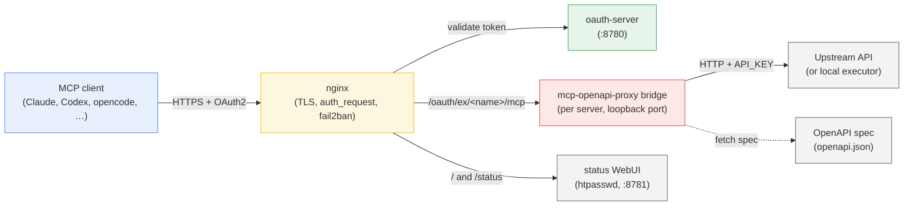

# mcp-gateway

A self-hosted **MCP gateway**: one TLS endpoint fronting many Model Context Protocol servers,
each generated from an OpenAPI spec by [`mcp-openapi-proxy`](https://github.com/matthewhand/mcp-openapi-proxy)
and exposed over Streamable HTTP. Authentication (bearer / OAuth2 / path-secret) and brute-force
protection are handled at the nginx edge. Add a new tool-server by adding one entry to `servers.json`.

> Renamed from the legacy "glama-bridge" - it is no longer glama-specific; glama is one of the running servers (see inventory).

## Why this exists

Connecting an LLM client (Grok, Claude, Letta, a web UI) to a dozen SaaS APIs normally means a
dozen bespoke MCP servers. Here, **one OpenAPI spec → one MCP server**, all behind a single
authenticated host. You get: uniform auth, per-server tool whitelisting (so a 844-tool API
becomes a focused 30), one TLS cert, one place to add/remove capabilities.

## Architecture

```
client ──TLS+auth──▶ nginx ──▶ mcp-openapi-proxy 0.4.0 (native Streamable HTTP :8801+) ──▶ upstream API
                      │           MCP 2026-07-28 · stateless POST /mcp · GET /healthz
                      └─ /oauth/* tokens issued & validated by oauth-server.py (:8780)
```

**Default (native):** `launch-server.sh` / `launch-glama.sh` `uv run` **mcp-openapi-proxy 0.4.0**
with `MCP_TRANSPORT=streamable-http` (uvicorn, not Node). MCP **2026-07-28**:
stateless `POST /mcp`, `GET /healthz`, no `Mcp-Session-Id`, no sticky nginx.
Path: client → nginx (bearer / OAuth JWT / grok path) → native `/mcp` → upstream API
(server key injected).

**Escape hatch (old wrapper):** `MCP_GATEWAY_HTTP=supergateway` wraps stdio through
supergateway instead of native uvicorn. That only changes the HTTP front — the engine
stays 0.4.0 unless you also pin.

**Full rollback** (deeper than the wrapper switch): pin `mcp-openapi-proxy~=0.3.4` and
`mcp>=1.2.0,<2`. Details in [`docs/RUNBOOK.md`](docs/RUNBOOK.md) (Engine version / transport).

Never foreground-curl `:8815` from inside Terminal Plus — use `./status.sh safe-probe <name>`
(RUNBOOK: Deadlock-safe probing). Do not expose `:8815` / `:3100` on `0.0.0.0`. The Terminal Plus
upstream itself is configurable — see [gpt-terminal-plus upstream configuration](#gpt-terminal-plus-upstream-configuration).

## What each file is

| Path | Purpose |
|---|---|
| **`bin/launch-server.sh <name>`** | Starts ONE tool-server from `servers.json[<name>]` (port, spec URL, env). **Default:** `uv run` mcp-openapi-proxy 0.4.0 native Streamable HTTP. **Old path:** `MCP_GATEWAY_HTTP=supergateway` wraps stdio (`supergateway --stdio "uvx …"`). Every `mcp-server@<name>` instance runs this launcher. |
| **`bin/launch-glama.sh`** | Same native-vs-supergateway switch. Launches glama (also reachable bearer-only at `/mcp`). Kept separate because glama predates the manifest. |
| **`bin/oauth-server.py`** | A small custom OAuth2 Authorization Server (auth-code + PKCE/S256, HS256 JWT access+refresh tokens). Serves `/authorize`, `/token`, `/register` (RFC 7591 DCR for public PKCE clients), `/.well-known/oauth-authorization-server` (`registration_endpoint` + `client_id_metadata_document_supported`), `/.well-known/oauth-protected-resource` (RFC 9728 path-scoped PRM), and `/validate` (nginx `auth_request`; 401 JSON `invalid_token` + `WWW-Authenticate` with `resource_metadata`). Static client from `$GLAMA_OAUTH_CONF`; DCR records in `$MCP_OAUTH_CLIENTS` (default `~/.state/mcp-gateway/oauth-clients.json`). HTTPS URL `client_id`s are fetched as CIMD (in-memory cache only). |
| **`servers.json`** | The manifest — the single source of truth for which servers exist. Per server: `port`, `spec_url`, `env` (API keys, `TOOL_WHITELIST`, auth-type overrides). **Gitignored. Carries no secrets — every key is a `${VAR}` ref** (non-secret knobs may use `${VAR:-default}`), expanded at launch by `bin/expand_env.py` from the gateway `.env` files (see Secret rotation in the RUNBOOK). |
| **`servers.example.json`** | Redacted copy of the manifest — every `env` value is a `${VAR}` ref (never a literal) so the repo documents the shape. |
| **`nginx/mcp.conf`** | The live vhost (TLS, routing, the three auth styles, fail2ban-friendly logging). **Gitignored — holds the bearer token + grok path-secret.** Symlinked to `/etc/nginx/sites-enabled/mcp.conf`. |
| **`nginx/mcp.conf.example`** | Redacted vhost for reference. |
| **`systemd/mcp-oauth.service`** | Unit for the OAuth server. |
| **`systemd/mcp-glama.service`** | Unit for the glama server. |
| **`systemd/mcp-server@.service`** | Template unit — `mcp-server@<name>` runs `launch-server.sh <name>` with `Restart=always`. |
| **`install.sh`** | Fresh-host deploy: checks prereqs, installs units, symlinks nginx, enables one server per manifest entry. |
| **`status.sh`** | CLI health snapshot — service states, per-server port/creds/whitelist, memory. `status.sh safe-probe <name>` is the deadlock-safe `/healthz` probe. |
| **`bin/safe-probe`** | Loopback `GET /healthz` (fallback: listen-only). Never foreground-curls the caller’s own port (`gpt-terminal-plus` `:8815`). |
| **`bin/box_key.py`** | Box `:8810` key gate — presence/expiry of `BOX_API_KEY` only (no secret dump). |
| **`bin/status_collect.py`** | Shared collector for the WebUI (uptime, systemd `NRestarts`, enabled, leftovers). |
| **`bin/status_web.py`** | Localhost status WebUI (`127.0.0.1:8781`), nginx-fronted at `/`, `/status`, `/status.html`, `/status.json`. |
| **`systemd/mcp-status.service`** | User/system unit for the status WebUI. |
| **`README.local.md`** | **Gitignored** — host-specific notes (real secret locations, this box's nginx/cert/DNS). Not in the repo. |

## Auth (pick per client)

| Style | Endpoint | Credential | Used by |
|---|---|---|---|
| Bearer | `POST /mcp` (glama only) | `Authorization: Bearer <token>` | simple clients |
| OAuth2 | glama `/oauth/mcp`, others `/oauth/ex/<name>/mcp` | `client_id=grok` + secret, auto-discovered | OAuth-capable clients |
| Path-secret | `/grok/<secret>` | the secret is the URL | the Grok connector |

Public host: `https://mcp.example.com` (legacy `glama-bridge.example.com` still aliased). On a real deployment this is your own hostname — set `MCP_PUBLIC_URL` in `.env.local`.

## How a request flows

A tool call from an MCP client reaches an upstream API through four layers:



- **Client → nginx** — TLS terminates at nginx; every MCP route is OAuth2-gated via an `auth_request` subrequest to the OAuth server (PKCE/S256, RFC 7591 DCR). The `/` status page is htpasswd, not OAuth.
- **oauth-server** — issues/validates access + refresh tokens and publishes RFC 9728 protected-resource metadata. Bridge tokens never reach the clients.
- **bridge** — one [`mcp-openapi-proxy`](https://github.com/matthewhand/mcp-openapi-proxy) process per server, bound to loopback. It reads the upstream OpenAPI spec, exposes it as MCP tools, and injects the server-side `API_KEY` so clients never hold credentials. Bridges are stateless, so they scale horizontally behind nginx (`least_conn`).
- **upstream** — the real API (or a local executor). Timeouts and concurrency are bounded per bridge so a slow upstream degrades one call, not the gateway.

**Status WebUI** (htpasswd, not OAuth): open `https://mcp.example.com/` — enabled MCP units, uptime, restart counts. Live restarts / port-down rows pulse; stale flap counts stay sorted/red but do not pulse. Same page at `/status` and `/status.html`; JSON at `/status.json`. Served by user unit `mcp-status` on `127.0.0.1:8781`. MCP tool routes are unchanged.

## Servers (live inventory, 2026-09-10 AEST)

`servers.json` and `servers.example.json` share **19** named entries (the documented SoT).
The routing table below lists those **19** plus glama / oauth / status (not manifest keys).
Parked CLIs (`vibe-cli`, `agy-cli`) are **not** in the manifest — see `configs/DISABLED-cli.md`.
**box** stays manual-only and **key-gated** (`BOX_API_KEY` empty/expired → skip bind, status UNHEALTHY).
**open-swarm-oracle** is discontinued on this host (removed from the manifest; see `configs/DISABLED-openapi.md`).
**wordpress-dev** is an MCP bridge to the Awardspace live `wp-json` API. It is **not**
a local WordPress container. **Disabled 2026-09-06** (manifest `enabled: false`, unit stopped + disabled;
watchdog, install.sh and status all honor the flag). The `servers.json` / example entry is kept with its
`${WP_DEV_API_KEY}` refs so it can be re-enabled later — until then `check-env-refs.sh` will
keep flagging that ref as unresolved, which is expected. The **local** WordPress deployment is
the wanted `wp-via-openapi` compose stack at `/mnt/models/projects/wp-via-openapi` (separate from
this bridge). The leftover vhost `wordpress.example.com` still proxies to `127.0.0.1:8088`.

**Live + keyed (mcp-server@ / mcp-glama):** glama (keyless), virustotal, slack, flyio, asana, render, notion, netbox, github, netlify, getzep (local Zep CE, Api-Key scheme auth since 2026-09-06), apisguru (keyless), wolframalpha (appid passed as a tool arg), gpt-terminal-plus (local shell/file executor; MCP tool annotations via engine 0.4.0 — [mcp-openapi-proxy#69](https://github.com/matthewhand/mcp-openapi-proxy/issues/69) / [PR #70](https://github.com/matthewhand/mcp-openapi-proxy/pull/70)). `box` is **manual-only** (short-lived creds). **open-swarm-oracle** is discontinued (unit disabled, not in `servers.json`). **wordpress-dev** is **disabled** (Awardspace live wp-json, draft-oriented — see note above).

**CLI bridges (mcp-cli-server@):** `openscad` / `gh-cli` / `oci-cli` / `acpx-cli` only.

### Routing & ports

Each MCP server is reachable at `https://mcp.example.com/oauth/ex/<name>/mcp` (OAuth2),
and glama additionally at `/mcp` (bearer) and `/grok/<secret>` (path-secret).

| Port | Server | Upstream |
|---|---|---|
| 8765 | glama | glama.ai (keyless) |
| 8780 | *oauth-server.py* | - (issues/validates `/oauth/*` JWTs) |
| 8781 | *status_web.py* (`mcp-status`) | - (htpasswd WebUI) |
| 8801 | flyio | api.machines.dev |
| 8802 | render | api.render.com |
| 8803 | slack | slack.com |
| 8804 | getzep | **local** Zep CE container `:8010` (Docker currently publishes `0.0.0.0:8010`; `Api-Key` scheme auth) |
| 8805 | virustotal | virustotal.com |
| 8806 | notion | api.notion.com |
| 8807 | asana | app.asana.com |
| 8808 | apisguru | apis.guru |
| 8809 | netbox | **local** NetBox container (`127.0.0.1:8080`) |
| 8810 | box | box.com *(manual-only, not running)* |
| 8811 | wolframalpha | wolframalpha.com |
| 8812 | github | api.github.com |
| 8813 | netlify | api.netlify.com |
| 8815 | gpt-terminal-plus | **local** gpt-terminal-plus `:3100` (override: `GPT_TERMINAL_PLUS_URL` / `GPT_TERMINAL_PLUS_PORT`) |
| 8816 | openscad | local CLI bridge `:3860` |
| 8817 | wordpress-dev | Awardspace live wp-json — **disabled 2026-09-06**, not listening |
| 8824 | gh-cli | local CLI bridge `:3868` |
| 8825 | oci-cli | local CLI bridge `:3869` |
| 8826 | acpx-cli | local CLI bridge `:3870` |

## Common operations

```bash
./status.sh                                   # CLI health snapshot
./status.sh safe-probe apisguru               # loopback /healthz (not :8815 from Terminal Plus)
# browser: https://mcp.example.com/  (htpasswd)

# add / change a server  → edit servers.json, then:
sudo systemctl restart mcp-server@<name>

# add an upstream API key → in that server's env in servers.json:
#   "API_KEY": "...",  plus if not Bearer:  "API_AUTH_TYPE": "api-key", "API_AUTH_HEADER": "x-..."
#   (NetBox: API_AUTH_TYPE=Token + SERVER_URL_OVERRIDE; Notion: EXTRA_HEADERS Notion-Version)

# cap tool count → "TOOL_WHITELIST": "/path1,/path2"  (prefix match; {param} placeholders ok)

# box on demand (needs BOX_API_KEY; empty/expired skips launch):
sudo systemctl start mcp-server@box   # ... and `stop` when done
```

## System / ops

- **Operator card:** [`docs/OPERATOR.md`](docs/OPERATOR.md) — one-page FQDN/issuer/units/status/hard-stops (not a RUNBOOK replacement).
- **Runtime deps:** `uv` / `uv run` (default: native mcp-openapi-proxy 0.4.0 Streamable HTTP),
  Python 3, nginx, certbot. Node (`npx supergateway`) is only needed when
  `MCP_GATEWAY_HTTP=supergateway`. Engine source: `MCP_OPENAPI_PROXY_SRC` (default `~/mcp-openapi-proxy`).
- **Ports:** oauth `:8780`, glama `:8765`, status `:8781`, servers per `servers.json` / the routing table above (port **8814** is free; open-swarm-oracle discontinued).
  OAuth/status bind localhost; native tool servers bind `127.0.0.1` (`MCP_HOST`). INPUT REJECT (not UFW) is the backstop. Only nginx :443 and :80 should be public.
- **systemd (user):** `mcp-oauth`, `mcp-glama`, `mcp-status`, `mcp-server@<name>` (13 running — `wordpress-dev` disabled 2026-09-06; excluding manual `box` and discontinued `open-swarm-oracle`), plus `mcp-cli-server@` for `openscad` / `gh-cli` / `oci-cli` / `acpx-cli`. `mcp-watchdog` is loaded but inactive. All running units use `Restart=always`. Unit **Description** lines for `mcp-server@` / `mcp-glama` name native mcp-openapi-proxy as the default and `MCP_GATEWAY_HTTP=supergateway` as the escape hatch (legacy “supergateway-default” wording retired). (Legacy `glama-*`/`mcp-example@` names retired 2026-06-18.)
- **TLS:** Let's Encrypt cert lineage `mcp` (covers `mcp.` + `glama-bridge.` names), auto-renews.
- **Security:** fail2ban jail `mcp-gateway-auth` bans repeated `401`/`403`s on `/mcp` and `/oauth/*`
  (12 fails / 10 min -> 1 h). `ignoreip` includes home ISP `219.90.166.149` (plus RFC1918 and
  `192.9.177.147`). `nginx-http-auth` and `mcp-gateway-auth` both have INPUT jumps via
  `jail.d/actionstart-always.local`. The only local WordPress deployment is the wanted
  `wp-via-openapi` stack (`/mnt/models/projects/wp-via-openapi`); the Awardspace
  `wordpress-dev` bridge is disabled. Native
  MCP ports bind `127.0.0.1`; do not expose `:8815` / `:3100` on `0.0.0.0`. No secrets in git.
- **Secrets (never in git):** `~/.config/mcp-gateway/oauth.conf` (OAuth client+JWT secret), `~/.config/mcp-gateway/bearer-token`
  (bearer), and the `env` API keys inside `servers.json`. See `README.local.md`.
  DCR public-client records (no secrets) live in `~/.state/mcp-gateway/oauth-clients.json` — also not for git.
- **Paths (XDG):** config in `~/.config/mcp-gateway/`, logs/state in `~/.state/mcp-gateway/`, caches in `~/.cache`/`~/.npm`.
- **Backups:** pre-consolidation loose files and config backups in `/mnt/models/archive/`.

## Raw shell-command audit logging (opt-in)

Off by default. The only per-request log line is `mcp rpc method=tools/call name=…`, which never contains tool arguments.

Set `MCP_LOG_RAW_COMMANDS=1` (in `/home/chatgpt/mcp-gateway/.env`, or inline in the unit's environment) to add one extra record **before** each shell command runs:

```text
mcp raw-command tool=post_command_execute_shell
cd /srv/app && npm run build     # the verbatim command, byte-for-byte
```

- `bin/launch-server.sh` execs the proxy under `env -i`, so it re-exports `MCP_LOG_RAW_COMMANDS` and `MCP_LOG_RAW_COMMAND_TOOLS` explicitly (and logs `raw command logging enabled: …` at startup). Nothing to set per server.
- **Restart required** — the flag is read per call but the process env is fixed at exec: `sudo systemctl restart mcp-server@<name>`.
- Emitted into `~/.state/mcp-gateway/servers.log`, same file as everything else.
- Scoped to shell-execution tools only (default `post_command_execute_shell,executeShell`); override with `MCP_LOG_RAW_COMMAND_TOOLS=name1,name2` when a new terminal upstream lands. Unrelated tools are never dumped.
- ⚠️ **May expose secrets.** Commands are logged verbatim with **no redaction** — by design, redaction would defeat the audit trail — so `export TOKEN=…`, `curl -H 'Authorization: Bearer …'` etc. land in the log in the clear. Enable only while debugging, then remove the flag, restart, and treat/rotate the log accordingly.

## gpt-terminal-plus upstream configuration

The `gpt-terminal-plus` bridge (`:8815`) proxies the terminal API process on the same host.
Its upstream URL is not hardcoded: `servers.json` refers to it as
`"${GPT_TERMINAL_PLUS_URL:-http://localhost:3100}"` (and
`spec_url` `"${GPT_TERMINAL_PLUS_URL:-http://localhost:3100}/openapi.json"`), so the
default stays exactly `http://localhost:3100` until you set something.

| Var | Meaning |
|-----|---------|
| `GPT_TERMINAL_PLUS_URL` | full upstream base URL, e.g. `http://localhost:4100`. Wins when set and non-empty. |
| `GPT_TERMINAL_PLUS_PORT` | used to build `GPT_TERMINAL_PLUS_URL` by setting it in the same env file — `GPT_TERMINAL_PLUS_PORT=4100` alone gives `http://localhost:4100`. Setting `GPT_TERMINAL_PLUS_URL=http://localhost:4100` directly is equally fine. |

Set them in **`/home/chatgpt/mcp-gateway/.env`** (sourced by `bin/launch-server.sh` before the
manifest is expanded; `GPT_TERMINAL_PLUS_PORT` alone is enough) or in the system drop-in for the
upstream unit (`/etc/systemd/system/gpt-terminal-plus.service.d/*.conf`, which feeds
`/etc/default/gpt-terminal-plus` via `EnvironmentFile=`). Then
`sudo systemctl restart mcp-server@gpt-terminal-plus` and re-check
`grep gpt-terminal-plus ~/.state/mcp-gateway/servers.log | tail`.

`${VAR:-default}` is the general form used across the manifest expansion (`bin/expand_env.py`):
value when the var is set and non-empty, `default` otherwise. Plain `${VAR}` keeps the literal
when unset — `bin/check-env-refs.sh` therefore never reports a ref that carries a default.

## Troubleshooting

- **Client connects but tools 401 on call** → the *upstream* service key is missing/invalid (layer 2),
  distinct from the gateway auth (layer 1). Add `API_KEY` for that server.
- **502 from a server** → its backend process is down: `systemctl status mcp-server@<name>` / `start` it.
- **OAuth client can't finish** → check `oauth-server.py` is up (`:8780`) and discovery returns the right issuer
  (`registration_endpoint` for DCR; `client_id_metadata_document_supported` for URL client_ids).
  Live nginx must proxy `/oauth/register`.
- **Spark lists tools but `tools/call` 401s / cannot bind metadata** → unauthenticated
  `POST /oauth/ex/<name>/mcp` must return **401 JSON** `{"error":"invalid_token"}` (not nginx HTML)
  with `WWW-Authenticate` `resource_metadata="https://…/.well-known/oauth-protected-resource<request-uri>"`.
  Live nginx needs `error_page 401 = @mcp_oauth_401` (see `nginx/mcp.conf.example` + `docs/CLIENTS.md`).
- **Tool not found** → it's filtered by that server's `TOOL_WHITELIST`.

## License

MIT — see [LICENSE](LICENSE).
