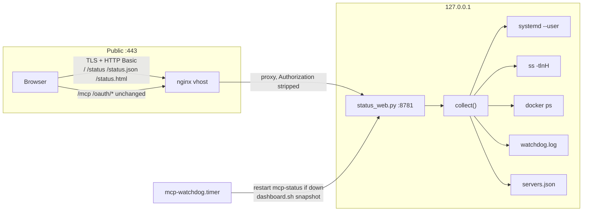
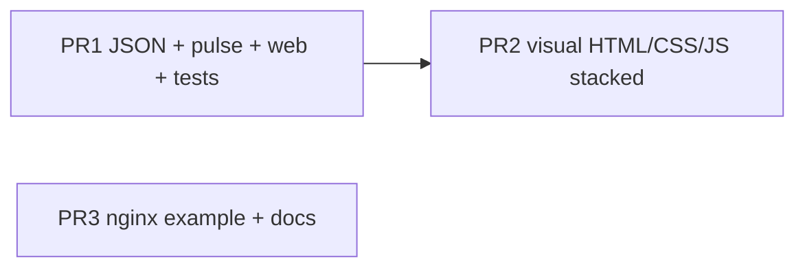

# MCP gateway status WebUI — UI specification and implementation design

| Field | Value |
|---|---|
| **Title** | MCP gateway status WebUI — UI spec + implementation design |
| **Author** | mcp-gateway maintainers |
| **Date** | 2026-08-18 |
| **Status** | Draft |
| **Audience** | Implementers shipping independently reviewable PRs against `/home/chatgpt/mcp-gateway` |
| **Live URL** | `https://mcp.example.com/` (also `/status`) |
| **Auth** | nginx `auth_basic "mcp-gateway status"` + `/etc/nginx/.htpasswd` on status routes only |

---

## Overview

The operator opens `https://mcp.example.com/` and must, within five seconds, know (1) which MCP services are enabled and up, (2) whether anything is wrong — **uptime first** — and (3) if anything is **restarting or flapping right now**. A collector and localhost WebUI already ship (`bin/status_collect.py`, `bin/status_web.py`, user unit `mcp-status` on `127.0.0.1:8781`, nginx htpasswd on `/` `/status` `/status.json` `/status.html`). The current page is a functional dark table that already sorts by severity then shortest uptime and pulses every `severity=bad` restart/down row.

That pulse is too loud: at design time the live fleet has **20/20 enabled up**, **9 issues**, and three units classified `bad` for historical `NRestarts` (openscad 6 / 12h, gpt-terminal-plus 5 / 17h, apisguru 10 / 20h). Those rows pulse forever even though they have been `active/running` and listening for hours. This document specifies a visual system the operator can pixel-match, a small JSON-contract evolution so “live problem” is a data field rather than a CSS guess, and a **three-PR DAG** (PR2 stacked on PR1; PR3 independent) that keeps the Python stdlib stack (no Node/React, no Docker for the gateway itself).

**Proposed solution:** keep the existing collector / ThreadingHTTPServer / nginx surface; make `collect()` emit a stable schema (`schema_version`, `pulse`, `live`, `thresholds`, structured `host.issues`); restyle `render_html()` (PR2 only) into a masthead + issue strip + core pills + two tables; pulse **only live** failures (`pulse_for` for services, `severity==bad` for core); poll by swapping `#app` every 10s without a second renderer; leave MCP `/mcp` and `/oauth/*` untouched.

---

## Background & Motivation

### Current state (shipped, live on this host)

| Piece | Path / fact |
|---|---|
| Collector | [`bin/status_collect.py`](bin/status_collect.py) — `collect()`, `classify()`, `render_html()`, `render_text()` |
| Web server | [`bin/status_web.py`](bin/status_web.py) — `ThreadingHTTPServer` on `MCP_STATUS_HOST=127.0.0.1`:`MCP_STATUS_PORT=8781`; routes `/`, `/status`, `/status.html`, `/status.json` (`/json` alias) |
| Units | [`systemd/mcp-status.service`](systemd/mcp-status.service) (system template) and `~/.config/systemd/user/mcp-status.service` (`WantedBy=default.target`, linger) |
| Nginx (live) | `/etc/nginx/sites-available/glama-bridge.conf` — `location = /`, `/status`, `/status.json`, `/status.html` with `auth_basic` + `proxy_set_header Authorization ""` + `Cache-Control: no-store` |
| Nginx (repo) | [`nginx/mcp.conf`](nginx/mcp.conf) (gitignored live copy) already has `location = /status.html`. [`nginx/mcp.conf.example`](nginx/mcp.conf.example) is the only drift — **missing** that location. |
| Snapshot fallback | [`bin/dashboard.sh`](bin/dashboard.sh) → repo-root `status.html`; invoked at the end of [`bin/watchdog.sh`](bin/watchdog.sh) |
| Watchdog | user timer `mcp-watchdog.timer` every 5 min; restarts `mcp-status` if down (lines 91–99 of `watchdog.sh`) |
| Tests | [`tests/test_status_collect.py`](tests/test_status_collect.py) — unittest, 15 tests, all passing via `python3 -m unittest tests.test_status_collect`. **pytest is not installed** on this host (`No module named pytest`) — do not switch. |
| CLI | [`status.sh`](status.sh) remains the one-command SSH snapshot; not replaced by the WebUI |
| Docs | README “Status WebUI” paragraph; [`docs/RUNBOOK.md`](docs/RUNBOOK.md) Health & self-heal; ROADMAP marks the dashboard shipped |

`collect()` already: reads `servers.json` without dumping `env`; `systemctl --user show` of `Id,LoadState,ActiveState,SubState,UnitFileState,NRestarts,ActiveEnterTimestamp,Result,ExecMainStatus`; `ss -tlnH` for listen; leftover `mcp-server@*` / `mcp-cli-server@*` not in the manifest; docker ps for `BACKENDS` (`netbox` → `netbox-docker-netbox-1`, `getzep` → `zep-ce-zep-1`); host `free -m` / `df -h /`; last 80 lines of `~/.state/mcp-gateway/watchdog.log`.

### Pain points

1. **5-second test fails on “is it restarting NOW?”** — `render_html()` adds class `pulse` whenever `severity==bad` and any issue string contains `restart` / `flapping` / `just started` / `down`. Historical `NRestarts >= 5` is `bad` even at 20 h uptime (`classify()` lines 227–229), so three stable units flash continuously.
2. **Restart cell color ≠ classify()** — `rest_cls` is `bad` if `n >= RESTARTS_BAD` (3), else `warn` if `n > 0` ([`bin/status_collect.py`](bin/status_collect.py) line 512). slack/netbox (`n=1`, 2d 19h, `severity=ok`, empty notes) show a **yellow** count; acpx/netlify (`n=3–4`) are already **red** in the restart cell even when the row is only `warn`. Neither matches “old single restart is table-only / ok”.
3. **Issue strip and table compete** — same information twice, no live-vs-stale grouping, leftovers mixed with flaps.
4. **Host pressure is footer-only** — live box at design time: disk 83% on `/`, swap 2555/2559 MB. Neither appears in the issues list; both are plausible causes of the restart counts.
5. **Core pills omit `mcp-status`** — watchdog already treats it as core; the page you are looking at is the only proof it is up.
6. **Containers dump the whole host** — 14 rows including `webcam`, `dogcam`, `homepage`. The operator needs the MCP backend stacks (`netbox-docker-*`, `zep-ce-*`, 8 of 14 today), not the camera/homepage leftovers.
7. **Full-page `meta refresh=10`** — flashes and resets scroll. Fine as noscript fallback, poor as the only live path.
8. **Example nginx drift** — live vhost has `/status.html`; `nginx/mcp.conf.example` does not.
9. **HEAD runs a full collect** — `Handler.do_HEAD` delegates to `do_GET` ([`bin/status_web.py`](bin/status_web.py) lines 68–69).

### Measured baseline (this host, 2026-08-18)

- `collect()` wall time: ~0.71 s cold, **~0.29 s** warm (re-measured 0.285 s; design-time first pass was 0.36–0.40 s). Budget remains **< 500 ms typical**. Two-wave runner parallelism is still in v1 for leftover correctness and cold-start, not because warm collect misses the budget.
- Snapshot `status.html`: **~10.9 KB**. Target after restyle: **≤ 40 KB** uncompressed, inline CSS/JS, **no CDN**.
- Fleet: 20 enabled + glama in the enabled table; `box` manual-off; leftover masked `vibe-cli` / `agy-cli`; `summary = {enabled: 20, manifest: 21, up: 20, issues: 9, restarting: 3, restarts_total: 37}`. `mcp-status` is **not** in `core` today (4 pills). `status.sh` already prints `mcp-status`.
- Host at first snapshot: mem **9478 MB** / disk 83% / swap 2555/2559. Re-measured later the same day: mem **1681 MB** / disk 83% / swap 2558/2559. After host issues land, this box will **not** show “All clear” until disk/swap recover.
- Manifest services (from live `servers.json` keys + hard-coded `glama`): flyio, render, slack, getzep, virustotal, notion, asana, apisguru, netbox, box, wolframalpha, github, netlify, gpt-terminal-plus, openscad, gh-cli, oci-cli, acpx-cli, wordpress-dev (disabled 2026-09-06), glama. `open-swarm-oracle` discontinued 2026-08-31.
- Bind: `127.0.0.1:8781` only. `/json` is a **localhost alias** on `status_web.py` and is **not** on nginx — keep it that way.

---

## Goals & Non-Goals

### Goals

- Operator 5-second read: healthy vs live incident vs “stale restart debt”.
- Show every **enabled** MCP unit from `servers.json` + `glama`, with uptime and `NRestarts`.
- Make **restarting-now / port-down / live flap** visually unmissable (pulse + issue strip + stat).
- Keep htpasswd **only** on `/`, `/status`, `/status.json`, `/status.html`.
- Keep bind `127.0.0.1` only; nginx is the public surface.
- Evolve `status_collect.py` / `status_web.py` / unittest; snapshot path `dashboard.sh` keeps working. pytest is absent — stay on `python3 -m unittest`.
- Stable `/status.json` for curl/ops and UI-contract tests; **no secrets** (no `env` values, tokens, spec URLs with credentials, htpasswd, bearer, grok path-secret).
- Accessible: semantic table, contrast, not color-alone, `prefers-reduced-motion`.
- Ship as three PRs with exclusive file ownership (PR2 stacked on PR1; PR3 independent).

### Non-goals

- Restart / enable / mask buttons, POST routes, or any write API (SSH + `systemctl --user` stays the control plane).
- New auth (OAuth, cookies, SSO). Existing `/etc/nginx/.htpasswd` users only.
- Node, React, npm, Vite, or a second web runtime on this box.
- Dockerizing the gateway or the status process.
- Replacing `status.sh`.
- Serving the WebUI on `0.0.0.0` or putting basic-auth on `/mcp` or `/oauth/*`.
- Per-request nginx metrics, TLS expiry card revival, tool-count enrichment (ROADMAP leftovers — out of scope).
- Auto-cleaning leftover masked units (`vibe-cli`, `agy-cli`).
- Pixel-perfect match to `webui/gateway-builder.html` (different job; tokens may rhyme, not copy).

---

## Job-to-be-done / 5-second test

**Job:** An operator (often on a phone or a laptop between other tabs) answers: *Is the gateway serving? Is any bridge dying right now? Which enabled services exist?*

**5-second scan path (strict order):**

1. **Masthead live chip** — if it says `LIVE` and a UTC timestamp within ~20 s, the status process itself is up.
2. **Issue strip** — first screenful. Green “All clear” vs a red/amber list. Live rows (restarting now / down / just started after a restart) are first and use the word **now**.
3. **Stat “live now”** — `0` green vs `N` red. This is the pulse count, **not** historical `NRestarts`.
4. **Pulsing table rows** — if anything is dying at this moment (`pulse_for` true, including **live flap** n≥5 with uptime < 10 m), it is the first body row and it pulses. Historical flaps (n≥5, uptime ≥ 10 m) do **not** pulse; they still sit at the top of the table with a red restart count.
5. **Enabled up `U/E`** — `20/20` means every enabled unit’s port is listening (or, if no port, `active`).

**Pass criteria (three canned states):**

| State | What the operator must conclude in 5s |
|---|---|
| **Healthy** | Issue strip: “All clear — no issues.” Live-now = 0. No pulse. Enabled up = all enabled. Core pills green. **Not expected on this host in v1** until disk < 80% and swap < 90% (see host issues). |
| **Live incident** (e.g. `apisguru` `activating/auto-restart`, port down, `NRestarts=10`, uptime 3 s) | Issue strip first line tagged `NOW`: `apisguru · restarting now (activating/auto-restart)`. Live-now ≥ 1. That row pulses. Uptime cell `3s` in red tabular nums. |
| **Stale flap debt** (design-time live fleet) | Issue strip is `issue-strip--bad` because flaps are still `bad`. Lines include `flapping — 6 automatic restarts` etc. **plus two host warn lines** (`disk 83% used …`, `swap … MB`). Live-now = 0. **No pulse** on the flap rows. Restarts column still red for ≥5. Sorted above ok rows. Operator sees debt + host pressure without a false fire alarm. |

---

## Information architecture

Above-the-fold on a 1080p laptop (~900 px content height) **must** contain masthead, stat grid, issue strip, core pills, and at least the first 3–4 enabled rows (the worst ones — `collect()` already sorts `SEVERITY_RANK` then shortest `uptime_sec` then highest `nrestarts` then name; [`bin/status_collect.py`](bin/status_collect.py) `sort_key`, lines 423–427).

```
Priority 1  Issues + live-now + shortest uptime
Priority 2  Enabled MCP services (full table)
Priority 3  Core units (oauth, glama, watchdog, nginx, status)
Priority 4  Disabled / leftover / manual
Priority 5  Backend containers (netbox, zep) then other docker
Priority 6  Host extras (swap, watchdog heals) in footer
```

**Enabled vs leftover split (keep current membership rules):**

- **Enabled table:** `expected and (enabled or not manual)` — i.e. every manifest+glama row except a manual-off `box`. A manifest unit that is **not** enabled (and not in `MANUAL`) stays in this table as `bad` / “not enabled”.
- **Disabled / leftover table:** leftovers (`vibe-cli`, `agy-cli`) + `MANUAL` off (`box`).
- `glama` is a service row **and** a core pill (today). Keep both: core = process health; table = port/uptime/restarts.

Do not merge the two tables. Leftovers must not dilute the enabled scan.

---

## Layout

### Breakpoints (one cut)

| Width | Name | Behavior |
|---|---|---|
| `≥ 900px` | Desktop | one-column wrap, 6-stat flex, Enabled column visible |
| `< 900px` | Narrow | 2-col stat grid, hide Enabled column, sticky first column |

There is **no** 720–899 special case. `900px` is the only layout breakpoint.

### Desktop (≥ 900 px)

Canvas: `max-width: 1120px`, horizontal padding `24px`, vertical `20px 24px 32px`. Background `--bg`. One column.

```
┌─ .wrap 1120px ──────────────────────────────────────────────┐
│ [masthead]                                                  │
│   h1 mcp-gateway          .live-chip  LIVE   .refresh 8s    │
│   .sub host · generated_at UTC                              │
│ [stat-grid] 6 cards, flex wrap, gap 10px                    │
│   enabled up | issues | live now | auto-restarts | mem | disk│
│ [issue-strip]  role=region aria-label=Issues                │
│   NOW lines in a small aria-live node; rest of list silent  │
│ [core] pills                                                │
│ [enabled] h2 + one-line hint + table                        │
│ [other]  h2 Disabled / leftover + table                     │
│ [containers] h2 Backend containers + table                  │
│             <details> Other host containers (N)             │
│ [footer] swap · watchdog last · heal count · auth note      │
│ [watchdog heals] only if recent_heals non-empty             │
└─────────────────────────────────────────────────────────────┘
```

**Regions (exact):**

| Region | Element | Contents |
|---|---|---|
| Masthead | `<header class="masthead">` | `<h1>mcp-gateway</h1>`; `<p class="sub">` `{host_url} · {generated_at}` `; chip from `data.get("source", "live")` (`LIVE` / `SNAPSHOT`); `.refresh` countdown `in Ns` (JS outside `#app` re-queries the node after every swap) |
| Stat grid | `<section class="stat-grid" aria-label="Summary">` | six `<article class="stat stat--ok\|stat--warn\|stat--bad">` |
| Issue strip | `<section class="issue-strip issue-strip--ok\|--bad\|--warn">` | heading “Issues”; `ul.issues-now` (`aria-live="polite"`) for NOW lines only; `ul.issues` for everything else |
| Core | `<section class="core">` | `<h2>Core</h2>` + pills |
| Enabled | `<section class="svc-block" id="enabled">` | table `#tbl-enabled` |
| Other | `<section class="svc-block" id="other">` | table `#tbl-other` |
| Containers | `<section class="svc-block" id="containers">` | backend table + `<details>` |
| Footer | `<footer class="foot">` | host + auth sentence |

Do not put a second H1. Section `h2` style: 12px, uppercase, letter-spacing 0.06em, color `--dim`, margin `22px 0 8px`.

### Narrow (`< 900 px`)

- Padding `16px`.
- Stat grid: `grid-template-columns: 1fr 1fr`; cards `min-width: 0`.
- Tables stay **semantic `<table>`** (a11y). Wrapper `.table-wrap { overflow-x: auto; }`. First column `th.n { position: sticky; left: 0; background: inherit; z-index: 1; }`.
- Hide the **Enabled** column: `@media (max-width: 899px) { .svc-table .col-en { display: none; } }` (header `th.col-en`, body `td.col-en`). The name cell already carries `.badge-en`.
- Notes / issues stay visible — they are the point — wrapping inside `td.iss` (`max-width: 42ch` on desktop, unconstrained on narrow).
- Core pills wrap.
- Minimum tap target for the “Issues only” toggle: 44×32 px.

Do not switch to a card-list layout in v1 (two templates). Horizontal scroll + sticky name is enough.

### z-index / sticky

Nothing sticky on Y (the issue strip scrolls away — the operator has already seen it). Horizontal sticky name only.

---

## Visual design tokens

Evolve the existing dark theme; do not invent a new brand. Values below are **normative**.

```css
:root {
  --bg:        #0b0f14;
  --bg-elev:   #0e141b;
  --panel:     #141b24;
  --panel-2:   #1a2330;
  --line:      #243240;
  --line-hi:   #314155;
  --txt:       #e6edf3;
  --dim:       #7d8da0;
  --muted:     #9aa7b5;   /* 12px labels on --bg; ≥ 4.5:1 */
  --ok:        #3fb950;   /* small text; #2ea043 kept as --ok-dim for fills */
  --ok-dim:    #2ea043;
  --ok-bg:     #12261a;
  --ok-line:   #24532c;
  --warn:      #d29922;
  --warn-bg:   #231c10;
  --warn-line: #5c4a1a;
  --bad:       #f85149;
  --bad-bg:    #2a1214;
  --bad-pulse: #4a1518;
  --info:      #58a6ff;
  --focus:     #58a6ff;
  --radius-sm: 8px;
  --radius:    10px;
  --radius-pill: 999px;
  --pad:       8px;
  --font:      14px/1.45 -apple-system, BlinkMacSystemFont, "Segoe UI", Roboto, sans-serif;
  --mono:      ui-monospace, "SF Mono", Menlo, Consolas, monospace;
}
```

**Type scale**

| Token | Size / weight | Use |
|---|---|---|
| Display | 22px / 700 | `h1` |
| Stat value | 26px / 700, `font-variant-numeric: tabular-nums` | `.stat .v` |
| Body | 14px / 400 | page |
| Uptime | 15px / 650, tabular | `.up` |
| Restarts | 15px / 700, tabular | `.rst` |
| H2 | 12px / 600, uppercase, ls 0.06em | section titles |
| Meta | 11px / 400, `--dim` | kind · badge, port listen, timestamps |
| Issue body | 13px / 400 | strip + `td.iss` |

**Spacing:** 4 px grid. Card pad `10px 14px`. Cell pad `8px 10px`. Section gap via h2 margin. Stat gap `10px`.

**Radius:** cards 10, tables 8 (overflow hidden), pills 999.

**Borders:** 1px `var(--line)`. Issue strip left accent `4px` (`--ok-dim` / `--warn` / `--bad`).

**Row fills:** `.svc-row--bad` → `--bad-bg`; `.svc-row--warn` → `--warn-bg`; `.svc-row--ok` → transparent on `--panel`. Hover (pointer only): `tr:hover { background: #18222d; }` — do not override `.svc-row--pulse` mid-frame. Sticky `th.n` uses `background: inherit` so pulse fill shows through.

**Focus:** `:focus-visible { outline: 2px solid var(--focus); outline-offset: 2px; }` on the issues-only toggle and `<details>`.

**Icons:** CSS `::before` squares/triangles, 8×8 px, `aria-hidden="true"`. Never emoji as the only signal.

| Severity | Mark | Color |
|---|---|---|
| ok | filled circle | `--ok` |
| warn | triangle | `--warn` |
| bad | square | `--bad` |
| live pulse | square + pulse fill | `--bad` |

---

## Component inventory

Every component lists **states**, **copy**, **DOM**, **what not to do**.

### 1. Masthead

**DOM**

```html
<header class="masthead">
  <div>
    <h1>mcp-gateway</h1>
    <p class="sub"><span class="host">https://mcp.example.com</span>
      · <time datetime="2026-08-18T21:25:56Z">2026-08-18 21:25:56 UTC</time></p>
  </div>
  <div class="masthead-right">
    <span class="chip chip--live">LIVE</span>
    <!-- or chip--snap SNAPSHOT -->
    <span class="refresh" aria-live="off">refresh 10s</span>
  </div>
</header>
```

| State | Chip | Notes |
|---|---|---|
| Live (`source=live`) | `LIVE`, border `--ok-line`, text `--ok` | stamped by `status_web.py` after `collect()` — **not** inside `collect()` |
| Snapshot (`source=snapshot`) | `SNAPSHOT`, border `--warn-line`, text `--warn` | stamped by `status_collect.main()` when `--html` is set. `dashboard.sh` **must** call `--html` (PR1). `data.get("source", "live")` if missing. |
| Collect failed | page is the 500 pre from `status_web.py`; no masthead | keep the existing `status collect failed: {e}` pre |

Copy: title is exactly `mcp-gateway`. Document title: `mcp-gateway status`. Do not add a tagline.

`.refresh` starts as `refresh 10s` in the server HTML. JS (outside `#app`) rewrites it to `in 9s` … `in 1s` and re-queries `.refresh` after every `#app` swap. See Interaction.

### 2. Stat cards

Six cards, order fixed:

| ID | `.k` label (exact) | `.v` | Color rule |
|---|---|---|---|
| `up` | `enabled up` | `{up}/{enabled}` | ok if `up==enabled` else bad |
| `issues` | `issues` | `{issues}` | ok if 0 else (bad if any `severity=bad` else warn) |
| `live` | `live now` | `{live}` | ok if 0 else **bad** |
| `restarts` | `auto-restarts (sum)` | `{restarts_total}` | ok if 0 else warn (never pulse this card) |
| `mem` | `mem available` | `{mem_avail_mb} MB` | `<500` bad; `<1500` warn; else ok (same as today) |
| `disk` | `disk / ({free} free)` | `{disk_used}` | parse %: `≥90` bad; `≥80` warn; else ok |

Empty/unknown: show `?`, class `stat--warn`.

**DOM (normative)** — BEM modifiers, not today’s `div.stat.ok`:

```html
<article class="stat stat--bad" id="stat-live">
  <div class="v">1</div>
  <div class="k">live now</div>
</article>
<article class="stat stat--ok" id="stat-up">
  <div class="v">20/20</div>
  <div class="k">enabled up</div>
</article>
```

`id` values: `stat-up`, `stat-issues`, `stat-live`, `stat-restarts`, `stat-mem`, `stat-disk`.

**Issues card color:** `stat--ok` if `summary.issues==0`; `stat--bad` if any service/core `severity==bad` **or** any `host.issues[].severity==bad`; else `stat--warn`. Host warn lines (disk 83%, swap ≥90%) turn this card warn even at 20/20 up.

**New vs today:** the third card is **`live now`**, not `restart / flap`. Stale flaps do not increment it. Host issues never increment `summary.live`.

### 3. Issue banner / empty-healthy state

**Empty (healthy)**

```
section.issue-strip.issue-strip--ok
  p.issue-empty
    “All clear — no issues.”
```

Green left accent. No `<ul>`. Do **not** use today’s `No issues detected.` (change is intentional; tests that `assertIn` the old string must update).

**Non-empty**

```html
<section class="issue-strip issue-strip--bad" role="region" aria-label="Issues">
  <ul class="issues-now" aria-live="polite">
    <li class="bad"><span class="now">NOW</span> <b>apisguru</b> · restarting now (activating/auto-restart) · uptime 3s · restarts 10</li>
  </ul>
  <ul class="issues" aria-live="off">
    <li class="bad"><b>openscad</b> · flapping — 6 automatic restarts · uptime 12h 8m · restarts 6</li>
    <li class="warn"><b>host</b> · disk 83% used (7.8G free)</li>
    <li class="warn"><b>host</b> · swap 2555/2559 MB</li>
  </ul>
</section>
```

- `issue-strip--bad` if any listed item is `bad` (service, core, **or** `host.issues[].severity`).
- `issue-strip--warn` if none are bad but any warn exists.
- Sort: NOW/pulse first (`ul.issues-now`), then other `bad`, then `warn` in `ul.issues`. Within a bucket keep collector order (severity, short uptime, name). Host lines come after service/core of the same severity.

**Line template (services):** `{name} · {issue} · uptime {uptime} · restarts {nrestarts}`

**Line template (core):** `{name} · {issue}`

**Line template (host):** `host · {message}` — `li` class from `host.issues[].severity`. `message` is the structured field, not a re-parsed string.

**Live prefix:** if `bool(row.get("pulse"))`, the line lives in `ul.issues-now` and prepends `<span class="now">NOW</span>` (small caps, `--bad`, 10px). Host issues never get NOW (they have no `pulse`).

Max 12 lines visible across both lists; if more, last line in `ul.issues`: `+{n} more in the table`. (Unlikely at ~25 units.)

**a11y:** `aria-live="polite"` is **only** on `ul.issues-now` (or an equivalent small node that contains just the NOW text). Do **not** set `aria-live` on the whole strip — a 10 s `#app` replace would re-announce stale flaps every poll. If there are no NOW lines, `ul.issues-now` is omitted (or empty); screen readers stay quiet.

### 4. Core service pills

`mcp-oauth`, `mcp-glama`, `mcp-watchdog`, `nginx`, **`mcp-status`** (new).

```html
<span class="pill pill--ok|pill--bad" title="mcp-oauth active/running">
  mcp-oauth <span class="pill-state">active</span>
</span>
```

| State | Classes | When | `pulse` |
|---|---|---|---|
| ok | `pill--ok` | `active==active` (timer `active/waiting` is ok) | false |
| bad | `pill--bad` | anything else | **true** |

Core `pulse = (severity == "bad")`. Do **not** run `pulse_for()` on core (no leftover/manual short-circuit, no `nrestarts`/`uptime_sec`). Example: `nginx` `inactive/dead` → `severity=bad`, `issues=["inactive/dead"]`, **`pulse=true`**, `summary.live += 1`. Add a unit test with a failed nginx core row.

`mcp-status` is circular (the page is the proof). Still show it: JSON consumers and the snapshot both benefit; a `SNAPSHOT` chip + `pill--bad` on mcp-status means “you are looking at a stale file because the live server is down”.

Do not add fail2ban as a pill (CLI-only in `status.sh`).

### 5. Service row

`<tr class="svc-row svc-row--{sev} [svc-row--pulse] [svc-row--leftover] [svc-row--manual]">`

Columns (enabled table): **Service · Enabled · State · Uptime · Restarts · Port · Notes**

`th` exact labels, lowercase as today: `service`, `enabled`, `state`, `uptime`, `restarts`, `port`, `notes`.

Name cell (row header — **not** `td.n`):

```html
<th scope="row" class="n">
  <span class="mark" aria-hidden="true"></span>
  <b>apisguru</b>
  <div class="meta">openapi · keyless</div>
  <span class="badge-en badge-en--on">enabled</span>
</th>
```

Enabled column: `<td class="col-en">…</td>` matching `<th class="col-en" scope="col">enabled</th>`.

**Pulse authority:** `bool(row.get("pulse"))` only. Missing key = **False**. Issue substrings must **not** be consulted in HTML (today’s `"restart" in i` is the bug; it would also pulse `short uptime after restart` if that row were ever `bad`).

**Row states** (`pulse` column is `pulse_for` for services; do not invent extra cases)

| State | Row class | Pulse | Notes cell (typical) | Example |
|---|---|---|---|---|
| ok | `svc-row--ok` | no | empty | github 2d 19h, rst 0 |
| ok + old single restart | `svc-row--ok` | no | empty | slack rst 1, 2d 19h — **restart cell is default color, not warn** |
| warn, restart debt 3–4 | `svc-row--warn` | no | `{n} automatic restarts` | asana 3, acpx-cli 4 |
| **short uptime after restart** (120 s–10 m, n=1–4) | `svc-row--warn` | **no** | `short uptime after restart ({uptime})` | n=2, up=5 m. Today’s HTML *would* pulse this if severity were bad because `"restart"` matches — `pulse_for` forbids it. |
| **just started, nrestarts=0** | `svc-row--warn` | **no** | `just started ({uptime})` | expected unit, 90 s, n=0 (`classify` warn). `pulse_for` requires `n>=1`. |
| bad, stale flap ≥5, **uptime ≥ 10 m** | `svc-row--bad` | **no** | `flapping — {n} automatic restarts` | apisguru 10 / 20 h |
| **live flap** (n≥5 and uptime < 10 m, or n≥5 and not actually up) | `svc-row--bad svc-row--pulse` | **yes** | `flapping — {n} automatic restarts` | apisguru n=10, up=30 s, listening |
| **restarting now** | `svc-row--bad svc-row--pulse` | **yes** | `restarting now ({active}/{sub})` | activating/auto-restart |
| **just started after restart** | `svc-row--bad svc-row--pulse` | **yes** | `just started ({uptime})` | uptime 90 s, nrestarts≥1 |
| **down** (enabled, not listening, not active) | `svc-row--bad svc-row--pulse` | **yes** | `down ({active}/{sub})` | failed/failed |
| **port-down-while-active** | `svc-row--bad svc-row--pulse` | **yes** | `port :{p} not listening (unit active)` | hung process, watchdog’s case |
| not enabled (expected, not manual) | `svc-row--bad` | no | `not enabled` | — |
| leftover masked/failed | `svc-row--warn svc-row--leftover` | no | `leftover unit (masked/failed, not in servers.json)` | vibe-cli |
| leftover running | `svc-row--warn svc-row--leftover` | no | `running but not in servers.json` | — |
| manual off | `svc-row--ok svc-row--manual` | no | empty | box |
| backend container down | `svc-row--warn` (or worse if already bad) | no | `backend container {name} is down` | netbox/getzep |
| **core nginx inactive/dead** (pill, not a service row) | `pill--bad` | **yes** (`severity==bad`) | `inactive/dead` | live += 1 |

Pulse is **never** applied to leftover, manual-off, stale flap (≥10 m uptime), just-started with n=0, short-uptime warn, or a 2-day-old single restart.

### 6. Uptime cell

```html
<td class="up [up--short|up--hot]">{uptime}</td>
```

- `format_uptime()` unchanged: `9s`, `1m`, `1m 15s`, `1h 0m`, `1d 1h`, `—` if not `active`.
- `up--hot` (`color: var(--bad)`): `uptime_sec < 120` **and** (`nrestarts≥1` or pulse).
- `up--short` (`color: var(--warn)`): `uptime_sec < 600` and not hot.
- Emphasize short uptime with the existing 15px/650 tabular style; long uptimes stay body weight 400 if `uptime_sec ≥ 3600` (quiet the healthy majority).

### 7. Restarts cell

```html
<td class="rst rst--0|rst--1|rst--3|rst--5">{n}</td>
```

| n | Class | Color |
|---|---|---|
| 0 | `rst--0` | `--dim` |
| 1–2 | `rst--1` | `--txt` (not warn) |
| 3–4 | `rst--3` | `--warn` |
| ≥5 | `rst--5` | `--bad` |

This **decouples** cell color from “was there ever a restart”. Matches `RESTARTS_BAD=3` / `RESTARTS_FLAP=5`.

### 8. Enabled badge

In the Enabled column (desktop) **and** as `.badge-en` under the name:

| `unit_file_state` | Copy | Class |
|---|---|---|
| enabled | `enabled` | `badge-en--on` (ok-line) |
| disabled | `disabled` | `badge-en--off` |
| masked | `masked` | `badge-en--mask` (warn) |
| other/empty | the raw state or `no` | `badge-en--off` |

Today’s cell says `yes` / `masked` / `disabled`. Change `yes` → `enabled` (clearer; tests that look for `>yes<` must update).

### 9. Kind / auth badge (meta line)

Keep `_badge()` values: `keyed` | `keyless` | `cli` | `manual` | `no key`. Display as text in `.meta`, not a color that could be confused with severity. `kind` is `core` | `openapi` | `cli`.

### 10. Port cell

`:{port}` plus `<span class="meta">up|down|—</span>`. `up` if `listening`; `down` if port set and not listening; `—` if no port. Color the meta `down` with `--bad` only when the row is expected and not manual.

### 11. Issues-only toggle (cheap, in scope)

Normative DOM — the checkbox is a **sibling** of `.table-wrap`, not nested in the label:

```html
<section class="svc-block" id="enabled">
  <h2>Enabled MCP services</h2>
  <p class="sub">Sorted by severity, then shortest uptime. Live restarts pulse; old restart counts do not.</p>
  <input type="checkbox" id="only-issues" class="visually-hidden">
  <label class="filter" for="only-issues">Issues only</label>
  <div class="table-wrap">
    <table class="svc-table" id="tbl-enabled">…</table>
  </div>
</section>
```

CSS (either is acceptable; sibling is enough):

```css
#only-issues:checked ~ .table-wrap tr.svc-row--ok { display: none; }
/* equivalent: .svc-block:has(#only-issues:checked) tr.svc-row--ok { display: none; } */
```

Default off. **Restore checked state across `#app` swap** the same way as `scrollY` (see Interaction). No URL state.

### 12. Container rows

Always-visible **backend** table — include a container if **any** of:

- `name` is in `BACKENDS.values()` (`netbox-docker-netbox-1`, `zep-ce-zep-1`)
- `name` starts with `netbox-docker-`
- `name` starts with `zep-ce-`

This is the **compose project**, not only the two mapped backends. Live host (14 docker rows) therefore shows **8** always-visible:

`netbox-docker-netbox-1`, `netbox-docker-netbox-worker-1`, `netbox-docker-redis-cache-1`, `netbox-docker-redis-1`, `netbox-docker-netbox-housekeeping-1`, `netbox-docker-postgres-1`, `zep-ce-zep-1`, `zep-ce-db-1`.

The other **6** (`homepage`, `glances`, `kokoro-tts`, `hivemind-pg`, `dogcam`, `webcam`) go in `<details class="more-dock">` summary `Other host containers (6)`. Highlight `state!=running` as warn. Do not filter docker in a second `docker ps` — one `docker ps`, split in Python.

### 13. Footer

Exact pattern:

`swap {used} / {tot} MB · watchdog last {last} · {heals} recent heal lines · htpasswd on / and /status only`

If swap used ≥ 90% of tot, wrap the swap clause in `<span class="warn">`.

Watchdog heals `<ul>` only when `recent_heals` is non-empty; heading `Recent watchdog heals`.

---

## Motion

| What | Animation | When |
|---|---|---|
| Live problem row | `pulse 1.2s ease-in-out infinite`; 50% background `--bad-pulse` | `svc-row--pulse` only |
| NOW tag | no extra motion (color is enough) | issue strip |
| 10 s body swap | none (instant replace) | JS poll |
| Stat numbers | none | — |

**Not animated:** stale flaps, leftover rows, warn-only restart debt, the `LIVE` chip, meta refresh (noscript).

```css
@keyframes pulse { 50% { background: var(--bad-pulse); } }
.svc-row--pulse { animation: pulse 1.2s ease-in-out infinite; }
@media (prefers-reduced-motion: reduce) {
  .svc-row--pulse {
    animation: none;
    box-shadow: inset 3px 0 0 var(--bad);
  }
}
```

Reduced-motion users still get a **3 px inner red bar** + NOW tag + text. Color is never the only cue.

---

## Copy (normative strings)

All `classify()` messages **stay** except where noted. They are the contract tests already pin (`"flapping"`, `"restarting now"`, `"just started"`, `"leftover"`, `"not enabled"`, `"down"`).

| Situation | Exact issue string |
|---|---|
| Live restart loop | `restarting now ({active}/{sub})` |
| NRestarts ≥ 5 | `flapping — {n} automatic restarts` |
| 3 ≤ n < 5 | `{n} automatic restarts` |
| 1–2 and uptime < 10 m | `{n} restart` / `{n} restarts` |
| uptime < 120 s and (nrestarts or restarting or expected) | `just started ({uptime})` |
| 120 s ≤ uptime < 10 m and nrestarts | `short uptime after restart ({uptime})` |
| expected, not listening, not active | `down ({active}/{sub})` |
| expected, not listening, active | `port :{port} not listening (unit {active})` |
| expected, not enabled, not manual | `not enabled` |
| leftover masked/failed | `leftover unit (masked/failed, not in servers.json)` |
| leftover running | `running but not in servers.json` |
| backend missing | `backend container {container} is down` |
| host mem | `memory {n} MB available` |
| host disk | `disk {pct} used ({free} free)` |
| host swap | `swap {used}/{tot} MB` |

**UI chrome (exact):**

| Slot | String |
|---|---|
| Issue empty | `All clear — no issues.` |
| Enabled hint | `Sorted by severity, then shortest uptime. Live restarts pulse; old restart counts do not.` |
| Enabled h2 | `Enabled MCP services` |
| Other h2 | `Disabled / leftover` |
| Containers h2 | `Backend containers` |
| Other docker summary | `Other host containers ({n})` |
| Filter | `Issues only` |
| Live chip | `LIVE` |
| Snapshot chip | `SNAPSHOT` |
| NOW tag | `NOW` |
| Auth footnote | `htpasswd on / and /status only` |
| 500 body | `status collect failed: {e}` (keep) |
| Empty other table | `none` |
| Page `<title>` | `mcp-gateway status` |

Do not say “unhealthy”, “degraded”, or “critical” — the existing three-level `ok|warn|bad` plus the strings above are the vocabulary.

---

## Interaction

| Action | Behavior |
|---|---|
| Load | Server-rendered HTML from `render_html(collect())`. Works with JS disabled. |
| Refresh | JS poll of `GET /status` every 10 s; replace `#app`; restore `scrollY` **and** `#only-issues` checked. One in-flight fetch. Countdown `in Ns` on `.refresh` after success. On failure: **`retrying…` for the whole 10 s backoff** (no `in 10s` overwrite). **Noscript:** `<meta http-equiv="refresh" content="10">` only inside `<noscript>`. Remove the current always-on meta refresh. |
| Issues only | CSS checkbox (sibling DOM). Restored on swap. No URL state. |
| Click row | no-op (no drill-in in v1). |
| Write / restart | **none**. |

### Why JS poll of HTML, not JSON hydration, not meta-only

- **One renderer.** `render_html()` stays the only visual implementation. A JS clone of the table **will** drift (this is the lesson of every dual template). Snapshot (`dashboard.sh`) keeps the same function.
- **JSON still exists** for curl, tests, and any future thin client; it is specified below and must stay secret-free.
- **Meta-only** fails the “don’t lose scroll / don’t flash” bar on a 23-row table the operator is reading.
- **JSON+JS render** is the strong alternative (see Alternatives) and is rejected for v1 to keep the operable surface = “Python file I can read on the box”.

Fetch URL is `/status` (not `/`) so a reverse-proxy mistake that maps `/` oddly still works. Credentials: same-origin, browser retries htpasswd automatically; nginx strips `Authorization` before Python.

If `fetch` fails (502 while `mcp-status` restarts): leave the current DOM, set `.refresh` to **`retrying…`**, and keep that string for the full 10 s backoff. Do **not** overwrite it with `in 10s`. Do not blank the page. Use a separate `backoff` counter for the 10 s wait; **`remain` is reset to 10 only after a successful swap**. `paintCountdown()` is skipped while `failed` is set. During an in-flight fetch, `remain` is **frozen** (interval returns immediately; do not decrement below 0, do not start another `tick`).

### Collect cache (single-flight)

Keep collect-on-request. Warm collect is already ~0.29 s. Add a **1.5 s in-process cache** in `status_web.py` (not in `collect()`), keyed by `ROOT`.

**Single-flight:** the lock is held **across** `collect()`, not only around the dict read/write. Two overlapping GETs that miss the cache must not both run systemd:

```python
_cache_lock = threading.Lock()
_cache = {"ts": 0.0, "data": None}  # keyed implicitly by process ROOT
CACHE_TTL_SEC = 1.5

def _snapshot():
    with _cache_lock:
        now = time.monotonic()
        if _cache["data"] is not None and (now - _cache["ts"]) < CACHE_TTL_SEC:
            return _cache["data"]
        data = collect(ROOT)          # lock held — single-flight
        data["source"] = os.environ.get("MCP_STATUS_SOURCE", "live")
        _cache["ts"] = time.monotonic()
        _cache["data"] = data
        return data
```

Collect exceptions are **not** cached (do not store; re-raise / 500). HTML poll + concurrent `/status.json` share one snapshot. Max 1.5 s staleness vs a 10 s UI period.

### HEAD

`do_HEAD` **must not** call `collect()` (inject a collector in tests). `Content-Length` may be omitted.

| Path | HEAD | GET |
|---|---|---|
| `/`, `/status`, `/status.html` | 200 `text/html; charset=utf-8`, empty body, no collect | 200 HTML from cache/collect |
| `/status.json`, `/json` | 200 `application/json`, empty body, no collect | 200 JSON |
| anything else | 404 `text/plain; charset=utf-8`, empty body, no collect | 404 `not found\n` |

`/json` stays localhost-only (not in nginx).

---

## Accessibility

- `<html lang="en">`. One `h1`. Sections with `h2`.
- Tables have `<caption class="visually-hidden">` (`Enabled MCP services` / `Disabled and leftover units`).
- `th scope="col"`. Name is the row header: first cell `<th scope="row" class="n">` (change from today’s `<td class=n>`). Never `td.n`.
- Severity is **mark + text + optional NOW**, not color alone.
- Issue strip `role="region"` `aria-label="Issues"`. `aria-live="polite"` **only** on `ul.issues-now` (NOW lines). The rest of the strip is `aria-live="off"`.
- Contrast: body `#e6edf3` on `#0b0f14` ≫ 4.5:1; `--ok` bumped to `#3fb950` for 12 px; large stat values may still use `--ok-dim`.
- Keyboard: only the checkbox and `<details>` are interactive; native focus.
- Auth is **browser HTTP basic**; no in-page login form.
- `prefers-reduced-motion` as above.
- Do not auto-focus. Do not use `marquee` / blinking `text-decoration`.
- `_esc()` remains mandatory for every interpolated string (name, issues, watchdog lines). Keep `test_html_escapes`.

---

## JSON contract (`GET /status.json`)

**Stability:** this document introduces **`schema_version: 1`** as the **first versioned** contract on a previously unversioned blob. Redefining `summary.restarting` (stale flaps no longer increment it; it is now an alias of `summary.live`) is allowed **once**, in v1. After v1 ships: additive fields allowed without bump; removals or meaning changes require a bump and a test failure.

**Auth / cache:** same htpasswd; `Cache-Control: no-store`; `X-Robots-Tag: noindex` (already in `_send`).

**Forbidden keys anywhere in the blob:** `env`, `API_KEY`, `token`, `spec_url`, `EXTRA_HEADERS` values, htpasswd, bearer, path secrets. `collect()` copies env **key names** for `_badge()` only, never `cfg["env"]` values or `spec_url`. Extend `CollectLiveShape.test_collect_sorts_issues_and_hides_secrets` (PR1): plant a fake `EXTRA_HEADERS` value; after `blob = json.dumps(data) + render_html(data)` assert `SUPER-SECRET-DO-NOT-LEAK` absent, fake extra-headers value absent, and `self.assertNotIn("spec_url", blob)`. Do **not** open the live vhost (`nginx/mcp.conf` / `/etc/nginx/sites-available/glama-bridge.conf`) looking for secret examples — that file holds MCP bearer / path-secret material out of scope for this UI.

### Top-level

```jsonc
{
  "schema_version": 1,
  "source": "live",               // "live" | "snapshot"
  "generated_at": "2026-08-18 21:25:56 UTC",
  "host_url": "https://mcp.example.com",
  "thresholds": {
    "uptime_just_started_sec": 120,
    "uptime_recent_sec": 600,
    "restarts_warn": 1,
    "restarts_bad": 3,
    "restarts_flap": 5
  },
  "summary": {
    "enabled": 20,
    "manifest": 21,
    "up": 20,
    "issues": 11,                 // 9 service rows with issues + 0 core + 2 host.issues
    "live": 0,                    // NEW: count of pulse==true (services + core). Host does not count.
    "restarting": 0,              // v1 alias of live (old meaning dropped once)
    "restarts_total": 37
  },
  "core": [ /* CoreRow */ ],
  "services": [ /* ServiceRow */ ],
  "containers": [ { "name": "...", "status": "...", "state": "running" } ],
  "watchdog": { "last": "2026-08-18T21:25:56Z", "heals": 0, "recent_heals": [] },
  "host": {
    "mem_avail_mb": 1681,
    "swap_used_mb": 2558,
    "swap_tot_mb": 2559,
    "disk_used": "83%",
    "disk_free": "7.8G",
    "issues": [
      { "severity": "warn", "message": "disk 83% used (7.8G free)" },
      { "severity": "warn", "message": "swap 2558/2559 MB" }
    ]
  }
}
```

**`summary.issues` formula (normative):**

```
len([s in services if s["issues"]]) + len([c in core if c["issues"]]) + len(host.issues)
```

Same as today for services+core (count **rows with any issue**, not issue strings — a service with both `flapping` and `just started` still counts as 1). Host contributes **`len(host.issues)`** (each structured item is one). Design-time live fleet: 3 flaps + 4 restart-debt + 2 leftovers + 0 core + 2 host = **11**. The canned JSON `issues: 9` is **wrong** once host issues exist.

**`summary.live` / `summary.restarting`:** count of `pulse==true` on **services + core**. Host issues never increment live. `restarting` is an alias of `live` in v1 (old substring count including stale flaps is dropped once; see stability above).

`host.issues` is a **structured** list, never bare strings. HTML uses `item["severity"]` for `li.bad|warn` — do not re-parse thresholds in the renderer.

### ServiceRow (current keys + two new)

Existing (keep): `name`, `kind`, `unit`, `port`, `enabled`, `unit_file_state`, `active`, `sub`, `load`, `nrestarts`, `uptime_sec`, `uptime`, `listening`, `expected`, `manual`, `leftover`, `badge`, `backend`, `backend_down`, `severity`, `issues`.

New:

| Field | Type | Meaning |
|---|---|---|
| `pulse` | bool | UI must pulse this row |
| `live` | bool | same as pulse for v1 (reserved if we later pulse without counting as live) |

### CoreRow

Existing: `name`, `unit`, `active`, `sub`, `enabled`, `severity`, `issues`.

Add `pulse` and `live`, both **`(severity == "bad")`**. Core rows do **not** go through `classify()` or `pulse_for()`. Do not apply leftover/manual short-circuits. A down nginx `{severity: "bad", issues: ["failed/failed"]}` (today’s core loop, `bin/status_collect.py` 429–448) **must** have `pulse=true` even though `"failed/failed"` does not start with `"down "` / `"port "`.

### `pulse` rule (normative, implemented in Python, consumed by HTML)

**`pulse_for()` is services only.** Core: `pulse = (severity == "bad")`. HTML: `bool(row.get("pulse"))` (missing = False). Issue substrings must not be consulted in HTML.

Computed **after** `classify()` so tests can target it directly:

```python
def pulse_for(row: dict, severity: str, issues: list[str]) -> bool:
    if row.get("leftover") or (row.get("manual") and not row.get("enabled") and row.get("active") != "active"):
        return False
    if severity != "bad":
        return False
    n = int(row.get("nrestarts") or 0)
    up = row.get("uptime_sec")
    restarting_now = (
        row.get("active") == "activating"
        or (row.get("sub") or "") in {"auto-restart", "start", "start-pre", "start-post", "stop-sigterm"}
        or "restart" in (row.get("sub") or "")
    )
    if restarting_now:
        return True
    if any(i.startswith("down ") or i.startswith("port ") for i in issues):
        return True
    if isinstance(up, int) and up < UPTIME_JUST_STARTED_SEC and n >= 1:
        return True
    if n >= RESTARTS_FLAP and isinstance(up, int) and up < UPTIME_RECENT_SEC:
        return True
    if n >= RESTARTS_FLAP and not isinstance(up, int):
        return True  # flap and not actually up
    return False
```

| Case | Who | pulse |
|---|---|---|
| apisguru, n=10, up=20 h, listening | `pulse_for` | **false** |
| apisguru, n=10, up=30 s, listening (live flap, uptime < 10 m) | `pulse_for` | **true** |
| n≥5, not actually up (`uptime_sec` missing) | `pulse_for` | **true** |
| activating/auto-restart | `pulse_for` | **true** |
| port not listening, unit active | `pulse_for` | **true** |
| just started, n≥1, up<120 s | `pulse_for` | **true** |
| just started, n=0, expected, up<120 s | `pulse_for` | **false** (classify warn only) |
| short uptime after restart, 120 s–10 m, n=1–4 | `pulse_for` | **false** (classify warn) |
| leftover masked | `pulse_for` | **false** |
| slack n=1, up=2 d | `pulse_for` | **false** |
| nginx `inactive/dead` / `failed/failed` | core `severity==bad` | **true** |
| mcp-oauth active | core | **false** |

`render_html()` **must** use `bool(row.get("pulse"))` (missing = False), not `row["pulse"]` and not issue substrings. Today’s string match is the bug. `test_html_escapes` currently omits `pulse`; after PR2 that fixture still works because `.get` defaults False.

**Assignment in `collect()` (PR1, not in `render_html`):**

```python
severity, issues = classify(row)
row["severity"] = severity
row["issues"] = issues
row["pulse"] = pulse_for(row, severity, issues)
row["live"] = row["pulse"]
```

Core loop (never `pulse_for`):

```python
core_row["pulse"] = core_row["severity"] == "bad"
core_row["live"] = core_row["pulse"]
```

`collect()` also sets `schema_version: 1`, `thresholds`, structured `host.issues`, and the `summary.issues` / `summary.live` formula. It does **not** set `source`.

---

## Classify rules (current + proposed)

Constants in [`bin/status_collect.py`](bin/status_collect.py) lines 22–27 — **do not change values in v1**:

```
UPTIME_JUST_STARTED_SEC = 120
UPTIME_RECENT_SEC       = 10 * 60
RESTARTS_WARN           = 1
RESTARTS_BAD            = 3
RESTARTS_FLAP           = 5
```

`MANUAL = {"box"}`. `KEYLESS = {"glama", "apisguru"}`. `BACKENDS` as above.

**Keep `classify()` severity table as-is** (tests in `Classify.*` lock it): leftover masked → warn; manual off → ok; not enabled → bad; restarting now → bad; down / port-down → bad; n≥5 → bad + “flapping…” even at 20 h; n≥3 → warn if not already bad; n≥1 and uptime<10 m → warn; just started + nrestarts → bad; backend down → warn if otherwise ok.

**Proposed tweaks (v1, all additive):**

1. **`pulse_for()`** — services only; see above. Severity stays `bad` for stale flaps so they remain sorted to the top and listed as issues; they just stop flashing. Core pulse is `severity == "bad"`.
2. **Host issues** — structured `host.issues: [{ "severity": "warn"|"bad", "message": str }]`, counted in `summary.issues` as `len(host.issues)`:
   - `mem_avail_mb < 500` → `{severity: "bad", message: "memory {n} MB available"}`
   - `mem_avail_mb < 1500` → warn, same message
   - disk used `% >= 90` → bad `"disk {pct} used ({free} free)"`; `>= 80` → warn
   - `swap_used_mb >= 0.9 * swap_tot_mb` (and tot>0) → warn `"swap {used}/{tot} MB"`
   On this host that is currently two warn lines (disk 83%, swap ~100%). They can turn the strip amber/red even at 20/20 up. “All clear” is **not** expected here until disk/swap recover. Do not special-case this box.
3. **`mcp-status` core row** from `systemctl --user show mcp-status` (add the unit to `units` in `collect()`).
4. **`source`** is **not** set inside `collect()`. One stamp line per caller:
   - `status_web._snapshot()`: `data["source"] = os.environ.get("MCP_STATUS_SOURCE", "live")`
   - `status_collect.main()` when `--html`: `data["source"] = os.environ.get("MCP_STATUS_SOURCE", "snapshot")`
   - `status_collect.main()` when `--json` / `--write-json`: same as `_snapshot()` (`"live"` default)
   Delete any hardcoded `data["source"] = "live"`.
5. **Two-wave runner parallelism** — leftovers are discovered from `list_units` **before** `show` (today `collect()` 340–368). A naive `ThreadPoolExecutor` over all runners would call `show` without leftover names and classify `vibe-cli`/`agy-cli` as `active=unknown`. Waves:

```python
from concurrent.futures import ThreadPoolExecutor, as_completed

def _run_wave(fns: dict[str, Runner]) -> dict[str, str]:
    out = {}
    with ThreadPoolExecutor(max_workers=8) as ex:
        futs = {ex.submit(fn): name for name, fn in fns.items()}
        for fut in as_completed(futs):
            out[futs[fut]] = fut.result()
    return out

# wave 1 — no leftover names needed
w1 = _run_wave({
    "list_units": lambda: runners["list_units"](),
    "ss": lambda: runners["ss"](),
    "show_system": lambda: runners["show_system"](["nginx"]),
    "docker": lambda: runners["docker"](),
    "free": lambda: runners["free"](),
    "df": lambda: runners["df"](),
    "watchdog": lambda: runners["watchdog"](),
})
leftovers = _scan_leftovers(w1["list_units"], known)
# append leftover units onto `units` (same as today)
# wave 2
shown = parse_show_blocks(runners["show"](units))  # includes leftovers
```

Injected `runners=` stay synchronous callables; the executor only fans those callables out. Keep `timeout=8` per `_default_run`. Tests that pass `runners=` must still work (no threads required if `collect` calls them the same way). **Required test:** a leftover unit’s `ActiveState` still comes from `show` (fixture `list_units` returns `mcp-cli-server@vibe-cli.service …`; `show` includes that unit’s block; `by["vibe-cli"]["active"] == "failed"`).

**Rejected tweak:** demoting n≥5 + long uptime from `bad` → `warn`. The operator asked for flapping to be obvious; a red row + issue line without pulse is the right obvious. Changing severity would also churn `Classify.test_flapping_is_bad` (72000 s / 10 restarts → `bad`) for no product gain.

---

## Proposed Design

### Architecture (keep)



### Request path

```mermaid
sequenceDiagram
  participant Op as Operator
  participant Ngx as nginx :443
  participant Web as status_web.py
  participant Col as collect()
  Op->>Ngx: GET / (no creds)
  Ngx-->>Op: 401 WWW-Authenticate Basic realm="mcp-gateway status"
  Op->>Ngx: GET / + Authorization: Basic ...
  Ngx->>Web: GET / (Authorization stripped)
  Web->>Col: collect(ROOT)  (1.5s cache)
  Col-->>Web: dict
  Web-->>Op: 200 text/html  (Cache-Control: no-store)
  Note over Op: t+10s JS
  Op->>Ngx: GET /status
  Ngx->>Web: GET /status
  Web-->>Op: 200 HTML; JS replaces #app, keeps scroll
```

### Module responsibilities

| Module | Role after this work |
|---|---|
| `status_collect.collect` | Pure-ish snapshot dict; injectable `runners`; schema_version 1; **does not set `source`** |
| `status_collect.classify` | severity + issue strings (unchanged rules) |
| `status_collect.pulse_for` | **new**, **services only** |
| `status_collect.render_html` | **only** visual implementation; **PR2 exclusive** — PR1 does not edit this function |
| `status_collect.render_text` | CLI (`status_collect.py` default) |
| `status_collect.main` | `--html` stamps `source=snapshot` then writes; `--json` stamps `source=live` unless `MCP_STATUS_SOURCE` set |
| `status_web.Handler` | GET/HEAD, single-flight cache, bind assert, stamps `source=live` |
| `dashboard.sh` | **required in PR1:** `python3 bin/status_collect.py --html "$OUT"` so snapshots get `SNAPSHOT` |
| nginx | auth surface only; no HTML |

### `render_html` skeleton (implementers match this DOM)

```html
<!DOCTYPE html>
<html lang="en">
<head>
  <meta charset="utf-8">
  <meta name="viewport" content="width=device-width,initial-scale=1">
  <title>mcp-gateway status</title>
  <noscript><meta http-equiv="refresh" content="10"></noscript>
  <style>/* tokens + components, inline, no @import */</style>
</head>
<body>
  <div id="app">
    <!-- header, stats, issues, core, tables, footer -->
  </div>
  <script>
  (function () {
    if (window.__mcpStatusPoll) return;
    window.__mcpStatusPoll = true;
    var PERIOD = 10000;
    var inFlight = false;
    var failed = false;
    var remain = PERIOD / 1000;
    var backoff = 0;  // used only after failure; do not paint
    function refreshEl() { return document.querySelector(".refresh"); }
    function paintCountdown() {
      if (failed || inFlight) return;  // keep "retrying…" across the backoff
      var el = refreshEl();
      if (el) el.textContent = "in " + remain + "s";
    }
    function tick() {
      if (inFlight) return;
      inFlight = true;
      // During fetch: remain is frozen (interval returns while inFlight).
      // It is typically 0 when tick() was entered from the countdown.
      var y = window.scrollY;
      var only = document.getElementById("only-issues");
      var wantOnly = !!(only && only.checked);
      fetch("/status", { cache: "no-store", credentials: "same-origin" })
        .then(function (r) { if (!r.ok) throw r.status; return r.text(); })
        .then(function (html) {
          var doc = new DOMParser().parseFromString(html, "text/html");
          var next = doc.getElementById("app");
          var cur = document.getElementById("app");
          if (next && cur) {
            cur.replaceWith(next);
            window.scrollTo(0, y);
            var box = document.getElementById("only-issues");
            if (box) box.checked = wantOnly;
          }
          failed = false;
          remain = PERIOD / 1000;  // reset remain only after success
          paintCountdown();
        })
        .catch(function () {
          failed = true;
          backoff = PERIOD / 1000;  // 10 s silent wait; remain unchanged
          var el = refreshEl();
          if (el) el.textContent = "retrying…";
        })
        .then(function () { inFlight = false; });
    }
    setInterval(function () {
      if (inFlight) return;          // remain frozen during fetch
      if (failed) {
        backoff -= 1;
        if (backoff <= 0) tick();    // still showing "retrying…"
        return;
      }
      remain -= 1;
      if (remain <= 0) { remain = 0; tick(); }
      else paintCountdown();
    }, 1000);
  })();
  </script>
</body>
</html>
```

Script is **outside** `#app`. First paint has no FOUC (CSS in head). Snapshot HTML includes the same script; if someone opens `status.html` as a file, `fetch('/status')` fails and the UI stays on the snapshot (chip already says `SNAPSHOT`).

### `status_web.py` changes (small)

```python
HOST = os.environ.get("MCP_STATUS_HOST", "127.0.0.1")
PORT = int(os.environ.get("MCP_STATUS_PORT", "8781"))
# Refuse to start on a non-loopback unless explicitly MCP_STATUS_ALLOW_NONLOCAL=1
CACHE_TTL_SEC = 1.5
```

On `status_web.main()`: if `HOST not in {"127.0.0.1", "::1", "localhost"}` and env allow-flag unset → log error and exit 2. Tests in `tests/test_status_web.py` **required** (PR1): non-loopback `main()` exits 2; HEAD does not call collect (inject); unknown path 404 without collect; cache is single-flight / TTL.

Cache: see single-flight snippet above. `collect()` exceptions are not cached. `_snapshot()` stamps source with **exactly** this line (no hardcoded `"live"` assignment elsewhere):

```python
data["source"] = os.environ.get("MCP_STATUS_SOURCE", "live")
```

Routes unchanged. Content-types unchanged. Do not add a public `/json` nginx location.

### Nginx (already correct on the live box)

Live `/etc/nginx/sites-available/glama-bridge.conf` already has all four locations. Repo example needs `/status.html`. Auth snippet to keep (and copy into the example):

```nginx
location = /status.html {
    auth_basic "mcp-gateway status";
    auth_basic_user_file /etc/nginx/.htpasswd;
    proxy_pass http://127.0.0.1:8781/status.html;
    proxy_set_header Host $host;
    proxy_set_header Authorization "";
    add_header Cache-Control "no-store" always;
}
```

Catch-all `location / { return 404; }` stays. Do **not** add `/static/` or extra unauthenticated paths.

**502 fallback (optional, PR3 if cheap):** `proxy_connect_timeout 1s; proxy_intercept_errors on; error_page 502 503 504 @status_snap;` named location that `alias`es `/home/chatgpt/mcp-gateway/status.html` **inside the same `auth_basic`**. Watchdog already `Restart=always` / `RestartSec=3` plus a 5 min timer; the window is seconds. Nice-to-have, not blocking.

### fail2ban

Live jail is **`mcp-gateway-auth`** (`/etc/fail2ban/jail.d/mcp-gateway.conf`, filter `/etc/fail2ban/filter.d/mcp-gateway-auth.conf`). Failregex is `/(?:mcp|oauth)` 401/403 only — status 401s **do not** ban MCP clients. Host jail `nginx-http-auth` is `enabled = true` in `/etc/fail2ban/jail.local` and may still catch basic-auth failures in the error log; that is desirable. Do not broaden the MCP jail to `/`. Do not add a public nginx `location = /json`.

PR3 must update RUNBOOK commands that still say `glama-bridge-auth` / `jail.d/glama-bridge.conf` to `mcp-gateway-auth`. Use the jail name `mcp-gateway-auth` everywhere in this design.

---

## API / Interface Changes

| Surface | Before | After |
|---|---|---|
| `GET /` `/status` `/status.html` | HTML, meta refresh 10 | HTML `#app` + noscript refresh + JS swap |
| `GET /status.json` | unversioned dict | `schema_version: 1` + additive fields |
| `classify(row)` | `(severity, issues)` | **unchanged signature** |
| `collect(...)` | dict | dict + new keys; old keys remain; **does not set `source`** |
| `pulse_for(row, sev, issues)` | n/a | new, **services only** |
| `render_html(data)` | table page | specified DOM (PR2); uses `bool(row.get("pulse"))` and `data.get("host", {}).get("issues") or []` |
| systemd / ports / auth | — | no change |
| `status.sh` | — | no change (already prints `mcp-status`) |

No new public routes. No POST.

---

## Data Model Changes

No database. The model **is** the JSON dict.

**Migration:** none. Old HTML clients just see nicer HTML after PR2. Anyone scraping `/status.json` for `summary.restarting` must read the v1 redefinition (now an alias of `summary.live`). Document in RUNBOOK one sentence (PR3).

**`source` is stamped by callers, never inside `collect()`:**

```python
# status_collect.main()
data = collect()
if args.html:
    data["source"] = os.environ.get("MCP_STATUS_SOURCE", "snapshot")
    Path(args.html).write_text(render_html(data))
elif args.json or args.write_json:
    data["source"] = os.environ.get("MCP_STATUS_SOURCE", "live")
    ...
```

```python
# status_web._snapshot() after collect(ROOT)
data["source"] = os.environ.get("MCP_STATUS_SOURCE", "live")
```

```bash
# bin/dashboard.sh — required in PR1 (no extra env needed; --html ⇒ snapshot)
ROOT="$(cd "$(dirname "$0")/.." && pwd)"
OUT="$ROOT/status.html"
exec python3 "$ROOT/bin/status_collect.py" --html "$OUT"
```

PR1 test: `main(["--html", path])` writes HTML containing `SNAPSHOT` (or `source` stamped snapshot before render). `collect()` itself has no `source` key unless the caller added it.

---

## Performance

| Budget | Target | How |
|---|---|---|
| `collect()` typical | **< 500 ms** | already ~0.29 s warm; two-wave executor for cold/leftovers; 1.5 s **single-flight** web cache |
| `collect()` timeout | 8 s per subprocess (existing) | if systemd hangs, empty string |
| HTML size | **≤ 40 KB** | inline CSS/JS, no images, no webfonts, no CDN |
| JSON size | **≤ 32 KB** for ~25 services | no logs except 8 heal lines |
| Concurrent tabs | ThreadingHTTPServer + single-flight cache | lock held across `collect()` |
| JS poll | 10 s, one in-flight | `if (inFlight) return` plus 1 s countdown timer outside `#app` |

Do not fetch docker for non-backend names in a second pass — one `docker ps` is enough; filter in Python.

---

## Alternatives Considered

### A. Keep meta refresh; only restyle CSS

- **Pros:** smallest diff; snapshot == live; no JS.
- **Cons:** full reload flash; cannot restore scroll; pulse logic still tied to issue substrings unless collector changes anyway.
- **Verdict:** rejected as the sole approach. Noscript keeps this behavior.

### B. Thin SPA: empty HTML + `fetch('/status.json')` + JS components

- **Pros:** JSON is the single contract; easy filter/sort later.
- **Cons:** dual maintenance or a JS framework; snapshot HTML from `dashboard.sh` would be empty without a bundler; box has no npm build step; JS-disabled operators see nothing.
- **Verdict:** rejected for v1. Revisit only if we grow drill-in views.

### C. Node/React (Next, Vite) behind nginx

- **Pros:** component library, motion.
- **Cons:** new runtime on a host that already fights RAM/swap; contradicts “no Docker for the gateway itself” and “Python stdlib”.
- **Verdict:** rejected. Strong no.

### D. Serve the existing `status.html` snapshot from nginx `alias` (pre-live-WebUI)

- **Pros:** no Python process.
- **Cons:** 5 min staleness (watchdog period); fails the “restarting now must be immediate” test.
- **Verdict:** already replaced; keep only as 502 fallback.

### E. Demote stale `NRestarts>=5` from `bad` to `warn`

- **Pros:** issue strip quieter.
- **Cons:** hides restart debt the operator currently cares about (`apisguru` 10). Pulse-vs-severity split is enough.
- **Verdict:** rejected.

### F. Add restart buttons (systemctl over D-Bus / sudoers)

- **Pros:** action from the page.
- **Cons:** turns htpasswd into a remote control plane; out of non-goals; auth file is shared with other vhosts on this box.
- **Verdict:** rejected.

### G. Extract `render_html` into `bin/status_html.py` so PR1/PR2 files do not overlap

- **Pros:** two people could edit different files off `main` the same day.
- **Cons:** extra move PR, extra import, extra review surface, slower than stacking. `render_html` is 130 lines in the same module as `_esc` and the data it consumes.
- **Verdict:** **rejected.** PR2 is stacked on PR1. PR1 does not touch `render_html`. No third file.

### H. Keep `summary.restarting` old meaning and only add `summary.live`

- **Pros:** no scraper surprise.
- **Cons:** the live page’s third card would still have to pick one; two counters that disagree is worse than one alias.
- **Verdict:** rejected. v1 is the first versioned contract; `restarting` becomes an alias of `live` once.

---

## Security & Privacy Considerations

| Threat | Severity | Mitigation |
|---|---|---|
| Status page unauthenticated | high | nginx `auth_basic` on exact locations only; catch-all 404 |
| Basic auth forwarded to Python | medium | `proxy_set_header Authorization ""` (already live) |
| Bind `0.0.0.0:8781` bypasses htpasswd | high | default 127.0.0.1; refuse non-loopback at startup |
| Secret leak via JSON/HTML | high | never copy `cfg["env"]` values or `spec_url`; tests plant `SUPER-SECRET-DO-NOT-LEAK` and a fake `EXTRA_HEADERS` value; `assertNotIn("spec_url", blob)`. Do not open the live vhost for examples. |
| XSS via unit names / watchdog lines | high | `_esc` on all interpolations; `test_html_escapes` |
| XSS via JS `innerHTML` of fetched HTML | low | we `replaceWith` a parsed `#app` from **our** origin; still escape server-side |
| Write actions as CSRF | n/a | no writes |
| fail2ban false ban of operator on htpasswd typo | low | jail `mcp-gateway-auth` ignores `/`; `nginx-http-auth` may ban brute force — acceptable |
| Page indexed | low | `X-Robots-Tag: noindex` |
| Info leak of internal unit names / ports | accepted | status is operator-only; ports are localhost |
| Snapshot file world-readable in the repo dir | low | `status.html` has no secrets; still not served without htpasswd |

Auth users: **do not invent new ones**. Rotate with `sudo htpasswd /etc/nginx/.htpasswd <user>` (RUNBOOK).

---

## Observability

| Signal | Where |
|---|---|
| Access | nginx `access_log /var/log/nginx/glama-bridge.access.log` (existing) |
| App errors | journal `SyslogIdentifier=mcp-status`; `Handler.log_message` already writes stderr |
| Collect failure | HTTP 500 + `status collect failed:` ; watchdog will restart the unit if the process dies, **not** if it serves 500s — acceptable |
| Self-heal | `~/.state/mcp-gateway/watchdog.log`; shown in footer + heal list |
| Metrics | none new. Do not add Prometheus for v1 |

**Alerting:** no new pager. The page **is** the alert surface. Optional later: watchdog already logs `CORE mcp-status not active`.

**Logging hygiene:** do not log Authorization, htpasswd, or `collect()` dumps of `servers.json`.

---

## Rollout Plan

The unit is **already live**. This is an in-place HTML/JSON swap.

1. **PR1** lands collector JSON + `pulse_for` + host issues + `status_web` + `dashboard.sh`. **Does not change `render_html`.** Live page still pulses stale flaps until PR2. `/status.json` is already the new contract.
2. **PR2 stacked on PR1** lands visual `render_html`. Because CSS is inline, there is no asset cache. `systemctl --user restart mcp-status` once so the process loads new code.
3. **PR3** (independent) updates `nginx/mcp.conf.example` + docs + RUNBOOK fail2ban jail name. Live nginx already has `/status.html`; **no nginx reload required** unless we add the optional 502 fallback (default: skip).

**Feature flags:** none. `MCP_STATUS_SOURCE` is an optional override on `status_web._snapshot()` / `status_collect.main()` only — `collect()` never reads it. Defaults: live process → `live`; `--html` → `snapshot`.

**Rollback:** `git revert` the HTML PR and restart `mcp-status`. Collector additive fields are backward compatible. To roll back JSON meaning of `summary.restarting`, revert PR1.

**Verify**

```bash
python3 -m unittest tests.test_status_collect tests.test_status_web
python3 bin/status_collect.py --json | python3 -c "import json,sys; d=json.load(sys.stdin); assert d['schema_version']==1; assert 'API_KEY' not in json.dumps(d); assert 'spec_url' not in json.dumps(d)"
curl -sS -o /dev/null -w '%{http_code}\n' --max-time 2 http://127.0.0.1:8781/   # 200
curl -sS -o /dev/null -w '%{http_code}\n' -u : https://mcp.example.com/  # 401
# with creds after PR2: 200; openscad/apisguru stale flaps have no svc-row--pulse; host warn lines present
ss -tlnH | grep 8781   # 127.0.0.1:8781 only
```

pytest is not installed — do not use it.

---

## Risks

| Risk | Sev | Mitigation |
|---|---|---|
| Dual-timer JS if script is duplicated inside `#app` | med | script **outside** `#app`; `window.__mcpStatusPoll` guard |
| Overlapping polls | low | `inFlight` flag; interval returns while in-flight (`remain` frozen) |
| Fetch failure overwrites countdown | low | `failed` + `backoff`; `.refresh` stays `retrying…` for 10 s; `remain` resets only on success |
| `summary.restarting` meaning change surprises a scraper | low | v1 first versioned contract; alias of `live`; RUNBOOK one-liner |
| Host issues light up the live box immediately (disk 83%, swap ~100%) | info | **intended** — “All clear” is not expected here until they recover |
| Leftover units missing from `show` if runners start together | **high if naive** | two waves: `list_units` (wave 1) then `show(units including leftovers)` |
| Sticky first column + row background looks wrong on pulse | low | `background: inherit` on `th.n`; pulse sets the `tr` background |
| 500 on collect leaves JS retrying a 500 HTML | med | JS checks `r.ok`; keep last good `#app` |
| Cache stampede | med | single-flight: lock held across `collect()` |
| `render_html` KeyError on old fixtures | med | `row.get("pulse")` missing=False; PR2 updates `test_html_escapes` keys |
| aria-live re-announces flaps every 10 s | med | live region is `ul.issues-now` only |

---

## Key Decisions

1. **Stay on Python stdlib + inline CSS/JS.** Operable on this box; no npm; matches how `status_web.py` already works.
2. **HTTP basic / htpasswd only, status routes only.** Already deployed; shared with other vhosts’ htpasswd file; do not invent a second user store.
3. **Pulse = live problems only; severity still flags stale flaps as `bad`.** Fixes the false fire alarm without hiding restart debt.
4. **One HTML renderer (`render_html`); JS swaps `#app` from `GET /status`.** Avoids a JS clone of the table. JSON is the machine contract, not the view model for v1.
5. **Do not change classify thresholds.** 120 s / 10 m / 3 / 5 are already tested and match systemd `RestartSec=3` plus watchdog cooldown 120 s (`MCP_WATCHDOG_COOLDOWN_SEC`).
6. **No write actions.** htpasswd is not a control plane.
7. **Host disk/swap/mem join the issue strip.** Uptime issues are often resource issues; the live box currently hides both.
8. **`mcp-status` becomes a core pill.** Watchdog already restarts it; snapshot vs live chip covers the circular case.
9. **Containers: compose backends first, everything else in `<details>`.** Prefixes `netbox-docker-` + `zep-ce-` (8 of 14 live rows), not only the two `BACKENDS` mapped names.
10. **unittest only.** pytest is **not installed** on this host. `schema_version: 1` is the first versioned JSON contract; `summary.restarting` may break its old meaning **once**.
11. **PR file ownership / no extract.** PR1 never edits `render_html`. PR2 is **stacked on PR1** and owns `render_html` + CSS/JS. HTML tests go in new `tests/test_status_html.py` (preferred) or a `RenderHtmlContract` class appended at the bottom of `tests/test_status_collect.py` — **do not edit** `CollectLiveShape` / `Classify`. PR3 is independent. Do not extract `bin/status_html.py`.
12. **`host.issues` schema + summary formula.** `host.issues` is `[{ "severity": "warn"|"bad", "message": str }]`. `summary.issues = len(service rows with issues) + len(core rows with issues) + len(host.issues)`. Host lines can turn a 20/20-up strip amber/red. `summary.live` counts `pulse==true` on services+core only; `summary.restarting` is an alias of `live` in v1.

---

## Open Questions

These are operator product choices, not implementation nits. **Defaults below are binding for implementers unless the operator replies later.** Do not stall PRs waiting for answers.

1. **Stale flaps (`NRestarts≥5`, uptime hours): keep `severity=bad` or demote to `warn`?** **Binding default:** keep `bad`, no pulse.
2. **Should host swap/disk issues appear at the same rank as a down MCP unit?** **Binding default:** **warn** for disk 80–89% and swap ≥90%; **bad** for disk ≥90% or mem <500 MB. They increment `summary.issues` (each host item counts 1) and can turn the strip amber/red even when every MCP port is up. They never increment `summary.live`.
3. **502 → static `status.html` fallback in nginx?** **Binding default:** skip in v1 (unit `RestartSec=3`); add in PR3 only if it stays a 10-line change that does not bypass htpasswd.

---

## References

- [`bin/status_collect.py`](bin/status_collect.py) — `classify`, `collect`, `render_html`, `format_uptime`, `unit_for`
- [`bin/status_web.py`](bin/status_web.py) — `Handler.do_GET`, bind `127.0.0.1:8781`
- [`tests/test_status_collect.py`](tests/test_status_collect.py) — 15 unittest cases to extend, not replace; PR1 adds `tests/test_status_web.py`
- [`systemd/mcp-status.service`](systemd/mcp-status.service), `~/.config/systemd/user/mcp-status.service`
- [`nginx/mcp.conf.example`](nginx/mcp.conf.example) vs live `/etc/nginx/sites-available/glama-bridge.conf`
- [`bin/watchdog.sh`](bin/watchdog.sh), [`bin/dashboard.sh`](bin/dashboard.sh)
- [`docs/RUNBOOK.md`](docs/RUNBOOK.md) Health & self-heal; [`docs/ROADMAP.md`](docs/ROADMAP.md) Observability shipped items
- [`README.md`](README.md) Status WebUI paragraph and port table (`8781`)
- fail2ban jail **`mcp-gateway-auth`** (`/(?:mcp|oauth)` 401/403 only). RUNBOOK still says `glama-bridge-auth` — PR3 fixes that.

---

## PR Plan

Three independently reviewable PRs. **File ownership is exclusive.** PR2 is stacked on PR1 — do not branch PR2 from `main`, do not inline a `pulse_for` fallback, do not extract a third file.



PR3 has **no Python dependency** and may land first or in parallel.

### PR1 — `status: JSON contract, pulse flag, host issues`

- **Depends on:** nothing
- **Files (exclusive):**
  - `bin/status_collect.py` — `collect()`, `pulse_for()`, `classify` **untouched**, `main()` source stamp. **Do not touch `render_html`.**
  - `bin/status_web.py` — bind guard, single-flight cache, HEAD without collect, stamp `os.environ.get("MCP_STATUS_SOURCE", "live")`
  - `bin/dashboard.sh` — **required** (keep `--html` so `main()` defaults `source` to snapshot)
  - `tests/test_status_collect.py` — JSON / `pulse_for` / leftover `show` / host.issues / secrets / nginx core pulse **inside existing `Classify` / `CollectLiveShape` / `FormatAndParse` only**. Existing `test_html_escapes` must still pass (renderer unchanged).
  - `tests/test_status_web.py` — **required** (new): HEAD does not call collect; unknown path 404 without collect; non-loopback `main()` exits 2; cache single-flight / TTL
- **Changes:**
  - Emit `schema_version`, `thresholds`, `summary.live`, redefine `summary.restarting` as alias of `live`
  - Add `pulse_for()` (services only); set `pulse`/`live` on each **service** from `pulse_for`; set core `pulse`/`live` to `(severity == "bad")`
  - Host issues as `[{severity, message}]`; `summary.issues` formula includes `len(host.issues)`
  - Add `mcp-status` to `units` and `core`
  - Two-wave runner parallelism (`list_units` wave 1, then `show` including leftovers)
  - `main(["--html", path])` writes `SNAPSHOT`; `collect()` does not set `source`
  - Tests: stale flap `pulse is False`; live flap up<10m `pulse is True`; restarting now `pulse is True`; just-started n=0 `pulse is False`; short-uptime warn `pulse is False`; failed nginx core `pulse is True`; leftover `active` still from `show`; `schema_version==1`; secrets + `spec_url` + fake `EXTRA_HEADERS` absent; host.issues structured
- **Out of scope:** `render_html`, CSS, JS, nginx, docs prose. Live HTML still pulses stale flaps until PR2.

### PR2 — `status: WebUI visual system`

- **Depends on:** **PR1** (stack / rebase onto `status/json-contract`). Do not start from `main`.
- **Files (exclusive once stacked):**
  - `bin/status_collect.py` — **`render_html` + inline CSS/JS only** (plus `_esc` if needed). Do not change `collect` / `classify` / `pulse_for`.
  - **`tests/test_status_html.py`** (preferred, new file) **or** append `class RenderHtmlContract(unittest.TestCase)` at the **bottom** of `tests/test_status_collect.py`. **Do not edit** `CollectLiveShape`, `Classify`, or `FormatAndParse` (including `test_html_escapes`). `render_html` uses `.get`, so that existing fixture stays green without new keys.
- **Changes:**
  - Implement the DOM, tokens, components, copy, noscript refresh, JS `#app` swap (countdown + `inFlight` + `failed` + restore `scrollY` and `#only-issues`), issues-only sibling CSS, backend-vs-other containers (8+6), reduced-motion, captions / `th.n[scope=row]`, `ul.issues-now` aria-live
  - `pulse` class from `bool(row.get("pulse"))` (missing = False)
  - Host strip lines from structured `host.issues`
  - Enabled column copy `yes` → `enabled`; empty issues copy `All clear — no issues.`
  - HTML tests live only in `RenderHtmlContract`. Assert on **named rows**, never `assertNotIn("svc-row--pulse", html)` on the whole document:
    - `openscad` from the existing `CollectLiveShape` runners (n=6, uptime ~2.7 h) **or** a hand-built service dict `{pulse: False, nrestarts: 10, uptime_sec: 72000, …}` → that `<tr>` has **no** `svc-row--pulse`
    - `apisguru` in the same `CollectLiveShape` collect fixture is `activating/auto-restart` → that `<tr>` **has** `svc-row--pulse`
    - Also: `id="app"` present; `th scope="row"` present; `prefers-reduced-motion` present; no `SUPER-SECRET` / `spec_url`
- **Out of scope:** collector rules, nginx, `status_web.py`, editing PR1 test classes

### PR3 — `status: nginx example + ops docs`

- **Depends on:** nothing (nginx hunk). Docs copy can land from this spec without waiting for PR2.
- **Files:** `nginx/mcp.conf.example` (add `location = /status.html` matching live; **do not** add `/json`), `README.md`, `docs/RUNBOOK.md` (WebUI + **`mcp-gateway-auth`** fail2ban commands replacing `glama-bridge-auth`), `docs/ROADMAP.md` (one iteration-log bullet)
- **Changes:** document htpasswd surface including `/status.html`; note `summary.restarting` v1 alias; no live nginx reload unless adding optional 502 fallback (**binding default: skip**)
- **Out of scope:** Python

### Worktree fan-out

```bash
git worktree add /tmp/mcp-gw-pr1 -b status/json-contract main
# PR2 starts AFTER PR1 exists, stacked:
git worktree add /tmp/mcp-gw-pr2 -b status/webui-visual  status/json-contract
git worktree add /tmp/mcp-gw-pr3 -b status/docs-nginx    main
```

Each Python PR must stay green with:

```bash
python3 -m unittest tests.test_status_collect tests.test_status_web tests.test_status_html
```

(`tests.test_status_html` exists after PR2 if that file was chosen; if PR2 appended `RenderHtmlContract` to `test_status_collect.py` instead, omit it.)

(`tests.test_status_web` exists after PR1. PR3 has no unittest.)

No other suite is required for merge.
